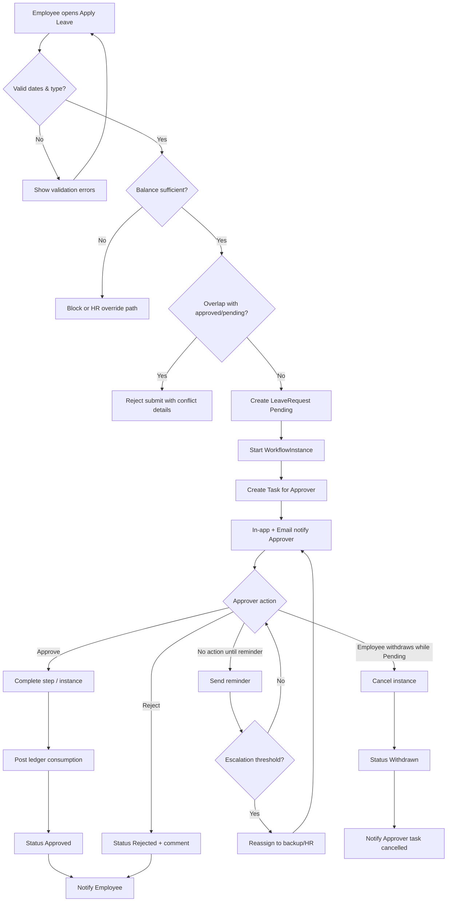
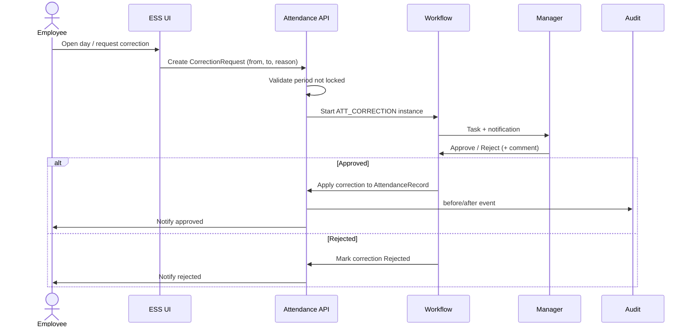
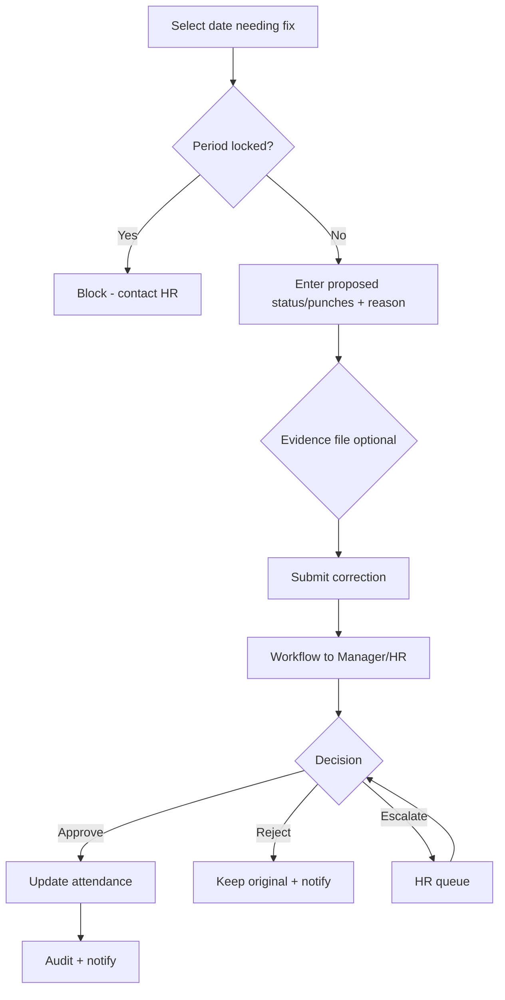
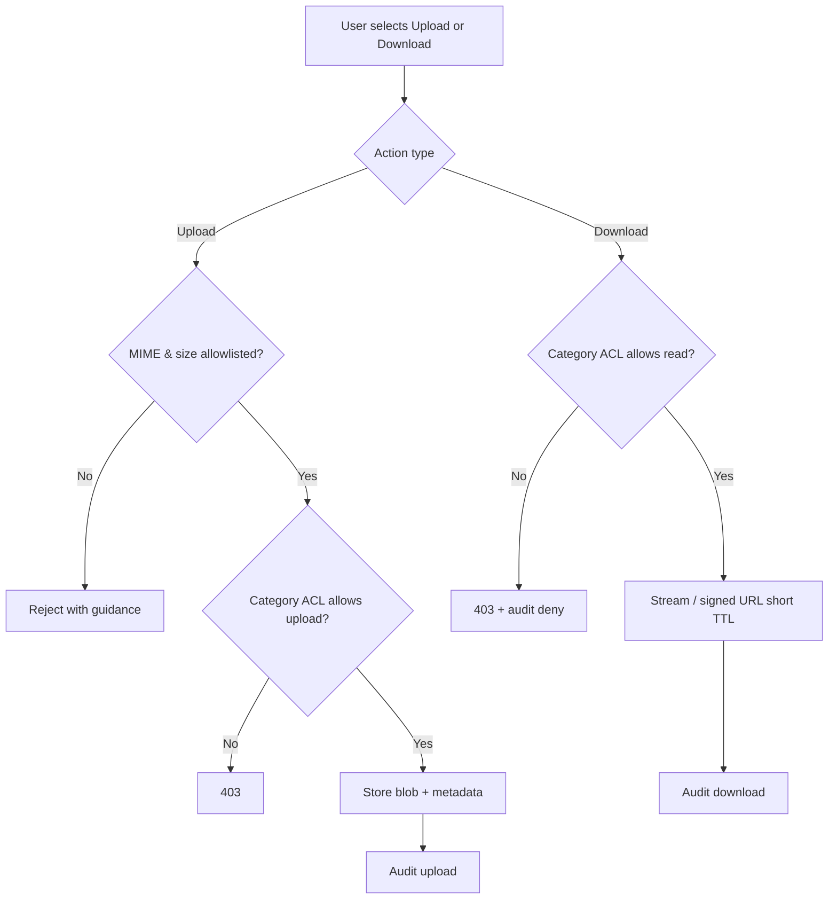
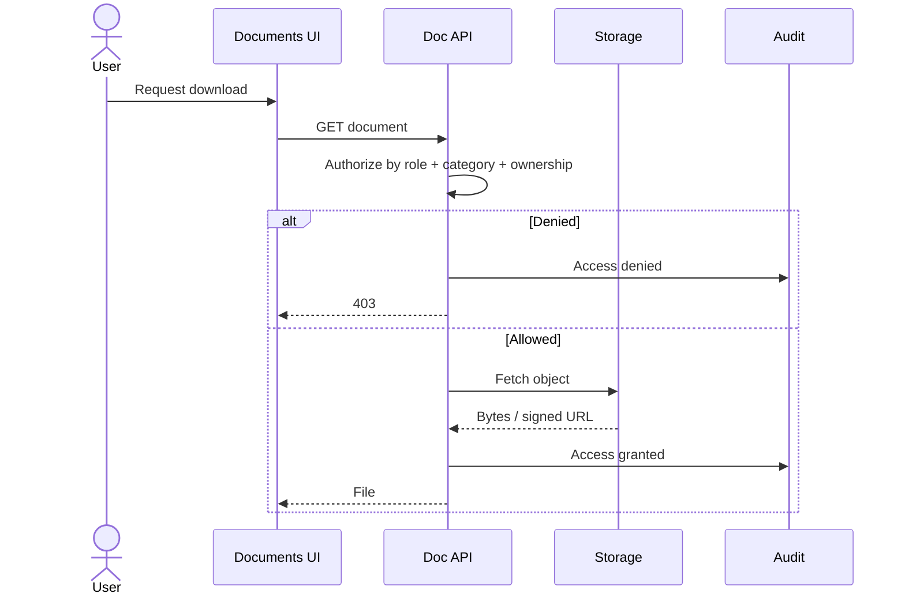
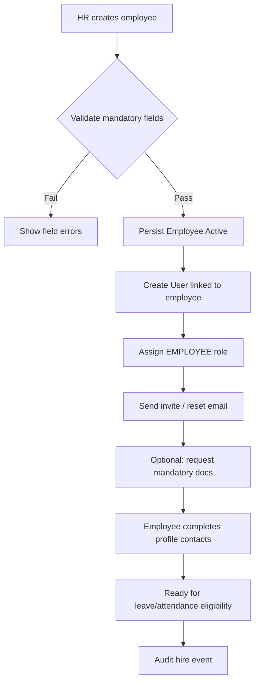
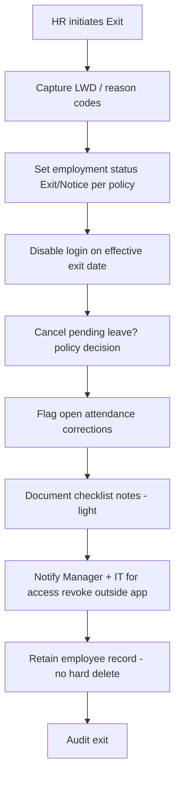
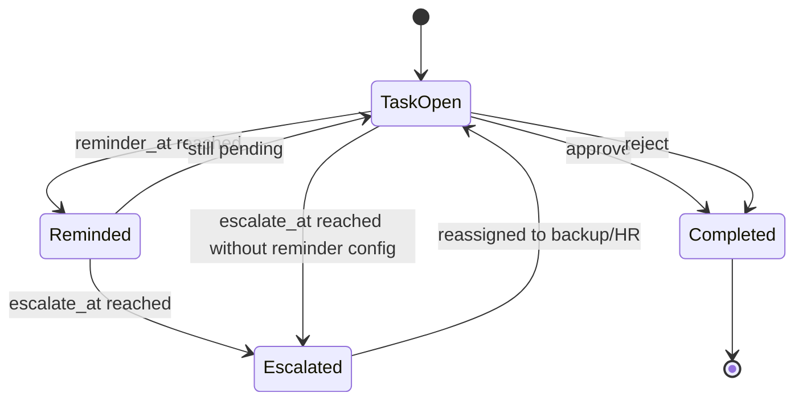
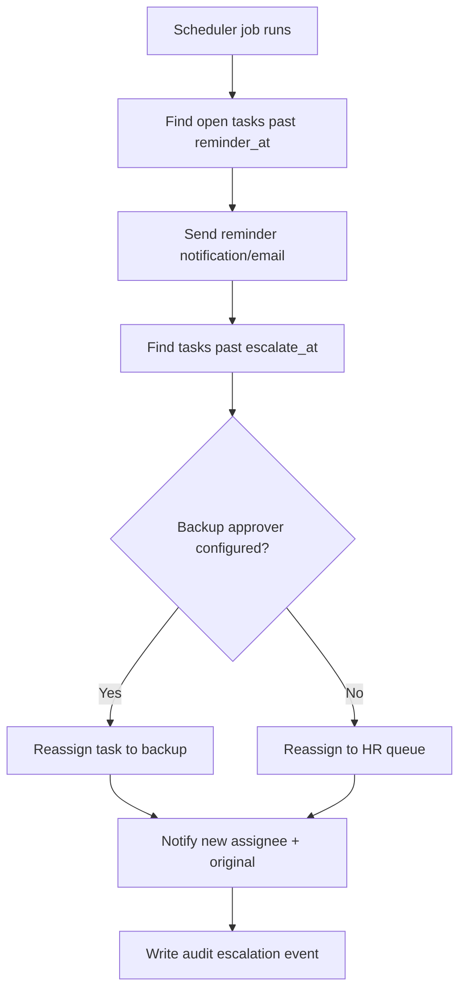
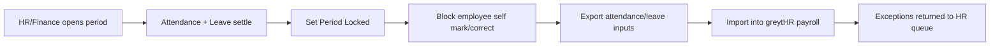

# 08 — Process Flows

**Product:** PeopleOS MVP  
**Related:** [05-product-requirements-mvp](05-product-requirements-mvp.md) · [06-srs-functional](06-srs-functional.md) · [09-ux-ui-specification](09-ux-ui-specification.md) · [33-implemented-workflow-catalog](33-implemented-workflow-catalog.md) (what the app does today; this file remains the spec)  
**Notation:** Mermaid flowcharts / sequence diagrams  
**Labels:** Happy path = solid; exceptions described in notes (**Assumption** where policy TBD)

---

## 1. Leave request & approval

**Maps to:** FR-LEAVE-003, FR-LEAVE-004, FR-WF-002, FR-WF-003, FR-NOTIF-*

**Business notes**
- Approver = reporting manager by default (**Assumption**).
- Half-day and holiday interaction follow policy flags (**Assumption** — freeze in Week 2).
- Concurrent withdraw vs approve: status check / version guard (**Estimate**).

---

## 2. Attendance correction

**Maps to:** FR-ATT-004, FR-WF-*, FR-AUD-001

**Business notes**
- HR break-glass direct correct allowed with mandatory reason (**Assumption**).
- Import after correction: last-write policy must be documented to avoid silent clobber (**Assumption**).

---

## 3. Document access (upload / download)

**Maps to:** FR-DOC-001, FR-DOC-002, FR-AUD-001

**Business notes**
- Stage A may lack full AV scanning; allowlist + size are compensating controls (**Assumption**/risk accepted until Stage B).

---

## 4. Employee join (hire)

**Maps to:** FR-CORE-002, FR-IDN-004, FR-DOC-001 (optional pack), FR-NOTIF-*

**Out of MVP / P1:** full preboarding portal, asset checklist automation, ATS offer acceptance sync.

**Light onboarding note (P0):** HR may attach joining letter via Documents; structured checklist is P1.

---

## 5. Offboarding (light)

**Maps to:** FR-CORE-003, FR-DOC-*, identity disable, audit

**Assumptions**
- Full IT asset recovery tracked in P1 Assets or external ITSM.
- Alumni portal deferred (P2).
- Pending leave: auto-reject vs allow consume through LWD — freeze in policy workshop.

---

## 6. Approval escalation

**Maps to:** FR-WF-004 (P1 stretch), FR-NOTIF-002; reminders = FR-WF-003 (P0)

**Configuration knobs (**Assumption** defaults)**
- Reminder: 24h after assignment  
- Escalation: 48–72h after assignment  
- Per-request-type overrides allowed for HR Head

---

## 7. Cross-flow: period lock (payroll coordination)

Not a full payroll engine — coordination only (**Fact**).

---

## 8. Flow-to-requirement traceability

| Flow | Primary FRs | Stories | UX screens ([09](09-ux-ui-specification.md)) |
|------|-------------|---------|-----------------------------------------------|
| Leave | FR-LEAVE-003/004, FR-WF-*, FR-NOTIF-* | US-LEAVE-03/04, US-WF-* | ESS Apply Leave; Manager Inbox |
| Attendance correction | FR-ATT-004, FR-WF-* | US-ATT-04 | ESS Correction; Inbox |
| Document access | FR-DOC-001/002 | US-DOC-01/02 | Documents library |
| Employee join | FR-CORE-002, FR-IDN-004 | US-CORE-02/03 | HR Employee Create |
| Offboarding light | FR-CORE-003 | US-CORE-04 | HR Exit dialog |
| Reminders | FR-WF-003 | US-WF-03 | Inbox + email |
| Escalation (P1) | FR-WF-004 | US-WF-04 | Inbox + email |

---

*Validate timers and leave edge policies in Weeks 1–2 workshops; update this file when Assumptions convert to Facts.*
