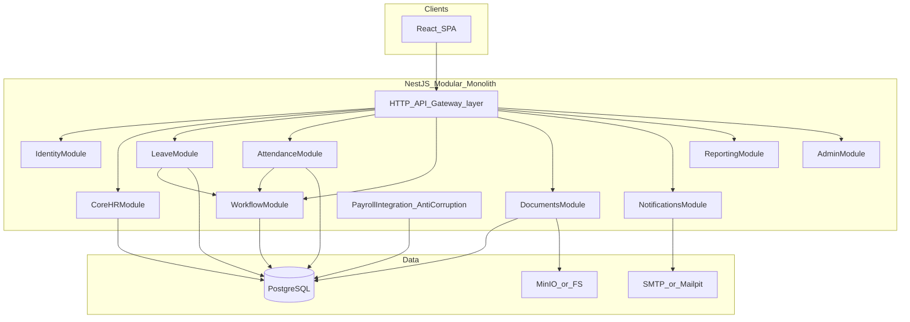

# 10 — System Architecture

**Stack (locked):** NestJS + React + PostgreSQL  
**Style (locked):** Modular monolith  
**Tenancy:** Single-tenant runtime; `tenant_id` on all tenant-scoped tables  

Related: [18-zero-cost-architecture.md](18-zero-cost-architecture.md) · [19-azure-target-architecture.md](19-azure-target-architecture.md) · [26-adrs/](26-adrs/)

---

## 1. Goals

1. Ship a secure internal HRMS MVP in 12 weeks with 4 engineers.  
2. Avoid architectural dead-ends for Azure and multi-tenant SaaS.  
3. Optimize for **changeability inside module boundaries**, not distributed microservices.  
4. Keep payroll as an **integration boundary**, not a core domain build.

---

## 2. Architecture decision summary

| Concern | Decision |
|---------|----------|
| Application shape | Modular monolith (NestJS modules = bounded contexts) |
| UI | React SPA (Employee, Manager, HR, Admin, CEO views via RBAC) |
| Data | PostgreSQL single database |
| Files | Local FS or MinIO → Azure Blob |
| Auth | Local JWT access + refresh; MFA-ready; OIDC later |
| Authz | RBAC + resource checks (manager of / self / HR) |
| Events | In-process domain events → Service Bus later |
| API | Versioned REST `/api/v1` + OpenAPI |
| Deploy Stage A | Docker Compose |
| Deploy Stage B | Azure Container Apps + Azure PostgreSQL + Blob + Entra |

---

## 3. Logical view

---

## 4. Module responsibilities

| Module | Owns | Must not own |
|--------|------|--------------|
| Identity | Users, credentials, sessions, roles mapping | Employee business attributes |
| Core HR | Org, employee, employment, dept, designation | Leave balances |
| Leave | Policies, balances, requests | Generic workflow engine internals |
| Attendance | Punches/marks, corrections, shifts light | Biometric device firmware |
| Workflow | Definitions, instances, tasks, escalation | Domain-specific business rules beyond hooks |
| Documents | Metadata, versions, ACL, storage keys | OCR/AI |
| Notifications | Templates, outbox, delivery attempts | Marketing campaigns |
| Reporting | Read models / queries for dashboards | Heavy BI warehouse |
| Admin | Feature flags (internal), system config | Tenant billing (deferred) |
| Payroll integration | Export job of attendance/leave inputs | Statutory calculations |

---

## 5. Cross-cutting concerns

| Concern | Approach |
|---------|----------|
| Tenancy | `tenant_id` column + Nest interceptor/repository guard |
| Audit | Append-only `audit_events` for sensitive mutations |
| Validation | Zod/class-validator at DTO boundary |
| Errors | Standard problem JSON envelope |
| Observability | Structured JSON logs + correlation ID; OTel hooks |
| Migrations | Prisma or TypeORM migrations (ADR: prefer Prisma or Drizzle — **Decision: Prisma** for speed) |
| Testing | Jest unit + supertest integration + Playwright smoke |

**ORM decision:** Prisma for MVP velocity and migration clarity ([ADR-002](26-adrs/ADR-002-database.md)).

---

## 6. Environment topology

### Stage A — Zero/minimal cost

Developer laptops + optional shared on-prem VM:

- `api` container (NestJS)  
- `web` container (nginx static React)  
- `db` PostgreSQL 16  
- `minio` (S3 API) optional  
- `mailpit` for email capture  
- `redis` optional (rate limit / cache)

### Stage B — Azure

- Container Apps: `api`, `web`  
- Azure Database for PostgreSQL Flexible Server  
- Blob Storage (private + SAS)  
- Entra ID OIDC  
- Key Vault secrets  
- Application Insights  
- Service Bus when async load requires  

---

## 7. Non-functional targets (MVP)

| NFR | Target (Estimate) |
|-----|-------------------|
| Concurrent users | 500 employees, burst ~50–100 concurrent |
| API p95 | &lt; 300ms for simple reads on local/pilot hardware |
| Availability pilot | Best-effort; production Azure later 99.9% goal |
| RPO/RTO pilot | Daily DB dump; RTO hours |
| Security | OWASP ASVS-inspired checklist; no public anonymous PII APIs |

---

## 8. Explicit non-goals

- Microservices / Kubernetes in MVP  
- Event-sourcing complexity  
- Multi-region active-active  
- Building payroll engine  

---

## 9. Mapping to Part 48

Final concise decisions: [appendices/part-48-final-recommendation.md](appendices/part-48-final-recommendation.md).
