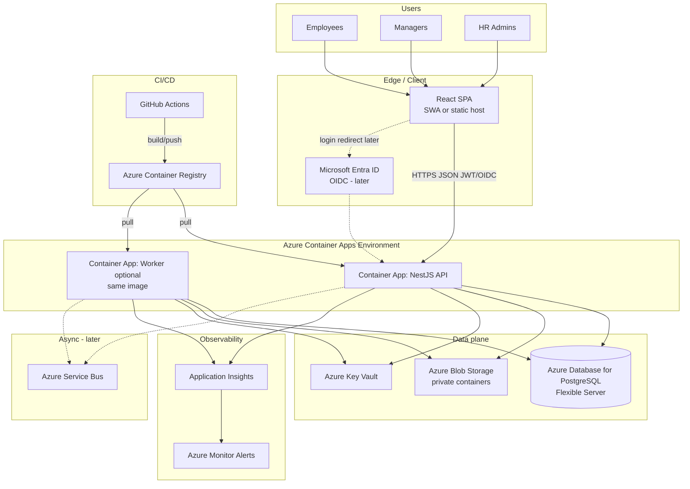

# 19 — Azure Target Architecture (Stage B)

**Status:** Preferred target after internal validation gates  
**Related:** [10-system-architecture](10-system-architecture.md), [18-zero-cost-architecture](18-zero-cost-architecture.md), [20-migration-strategy](20-migration-strategy.md), ADR-010, ADR-012  
**Discipline:** Justify each service; **reject AKS** unless scale/ops justify; **no invented Azure prices**.

---

## 1. Goals

1. Host PeopleOS with managed data, identity, secrets, and observability.  
2. Match team size (~4 engineers) — minimize Kubernetes tax.  
3. Preserve modular monolith (one primary API container).  
4. Enable Entra ID and Service Bus **when needed**, not on day one of Stage B.

| Statement | Label |
|-----------|-------|
| Prefer Azure Container Apps over AKS for this team size | **Fact** (locked preference) |
| Azure Database for PostgreSQL, Blob, Entra ID, Key Vault, Monitor/App Insights | **Fact** (locked) |
| Service Bus later | **Fact** (locked) |
| User scale ~500 employees internal | **Estimate** |

---

## 2. Service selection (justified)

### 2.1 Include

| Service | Purpose | Why justified |
|---------|---------|---------------|
| **Azure Container Apps** | Run NestJS API (and optional worker revision) | Scale-to-zero/min replicas, HTTP ingress, revisions, enough for monolith; far less ops than AKS |
| **Azure Container Registry** | Store images | Private images for ACA pulls |
| **Azure Database for PostgreSQL – Flexible Server** | System of record | Managed backups/PITR, TLS, maintenance; matches Stage A engine |
| **Azure Blob Storage** | Documents / exports | Durable, cheap object storage; private containers; signed URLs (SAS) |
| **Azure Key Vault** | Secrets, signing keys | Central secret store; audit; integrate via Managed Identity |
| **Azure Monitor + Application Insights** | Logs, metrics, traces | Native with ACA; supports OTel bridge |
| **Microsoft Entra ID** | SSO later | Enterprise identity; MFA/Conditional Access org-wide |
| **GitHub Actions** | CI/CD | Already in Stage A; OIDC to Azure |
| **Managed Identity** | Passwordless Azure access | API → KV/Blob/PG (where supported) |

### 2.2 Include later (explicit)

| Service | Trigger to adopt |
|---------|------------------|
| **Azure Service Bus** | Need durable cross-system messaging beyond DB outbox (payroll sync at volume, fan-out) |
| **Azure Cache for Redis** | Measured cache/queue need not met by PG/outbox |
| **Azure Static Web Apps** or **Front Door/CDN** | Hardening global static delivery / WAF |
| **Azure Communication Services – Email** | If org SMTP unavailable |
| **Private Endpoints / VNet integration** | Security review requires private data plane |
| **Azure Bastion / jump** | Admin access patterns |

### 2.3 Reject for Stage B (default)

| Service | Reason to reject |
|---------|------------------|
| **AKS** | Cluster upgrades, node pools, networking, ingress controllers exceed benefit at ~500 users / 4 engineers. Revisit only if: many services, GPU, complex mesh, or platform team exists. |
| **Azure Service Fabric** | Niche; not aligned |
| **Cosmos DB** | Wrong default vs relational HR data |
| **API Management** | Useful later for external partners; unnecessary internal MVP tax |
| **Event Hubs / Kafka** | Overkill vs Service Bus later |
| **Multi-region active-active** | Premature without SLA mandate |

**Estimate:** AKS would consume disproportionate Sprint capacity vs product features.

---

## 3. Logical architecture (Mermaid)

---

## 4. Container Apps design notes

| Topic | Recommendation | Label |
|-------|----------------|-------|
| Images | One API image; worker = same image, different command | **Assumption** |
| Ingress | External HTTPS for API; internal only for worker | **Fact** pattern |
| Scaling | Min replicas ≥ 1 for business hours initially (avoid cold-start pain for HR) | **Assumption** |
| Secrets | Prefer Key Vault references / MI over plaintext app settings | **Fact** good practice |
| Revisions | Blue-green via ACA revisions | **Fact** capability |
| CPU/memory | Start small; **Metric-to-measure** after UAT load | **Estimate** — do not over-provision blindly |

---

## 5. Data & storage

| Concern | Design |
|---------|--------|
| PostgreSQL | Flexible Server; TLS; firewall / VNet as matured; automated backups |
| Migrations | Run from CI job or one-off Job container with network to PG — not from laptop ad hoc in prod |
| Blob | Separate containers: `docs`, `exports`; lifecycle policies later |
| SAS | Short-lived; app checks authz first |
| Backup of blobs | Soft delete / versioning enabled when available |

---

## 6. Identity evolution on Azure

| Phase | Pattern |
|-------|---------|
| B0 | Keep local JWT; API on ACA; Entra not required for first Azure hosting |
| B1 | Add Entra OIDC; link users; enforce Conditional Access via Entra |
| B2 | Optional: App Roles / Group → RBAC mapping |

Hosting on Azure ≠ mandatory Entra day one, but **Stage B should not invent a second cloud IdP**.

---

## 7. Networking (pragmatic path)

**Path 1 — Simple (early Stage B):**  
Public ACA ingress + PG firewall allow ACA egress IPs / public access restricted + Blob private with SAS.

**Path 2 — Hardened:**  
VNet-integrated ACA, Private Endpoint to PG and Blob, limited public exposure via Front Door.

Choose Path 1 to reduce delivery risk unless security mandates Path 2 (**Assumption:** Path 1 for first Azure cutover).

---

## 8. Observability

| Signal | Tool |
|--------|------|
| Requests/dependencies | Application Insights |
| Container metrics | Azure Monitor |
| Alerts | Error rate, 5xx, CPU, PG storage |
| Audit trail | Still in PostgreSQL (app audit table) + ship security logs |

Retain OTel instrumentation from Stage A (ADR-011).

---

## 9. Cost discipline (no invented prices)

| Practice | Intent |
|----------|--------|
| Use Azure Pricing Calculator with **current** SKUs at approval time | Leadership numbers must be refreshed |
| Prefer Flexible Server SKU sized for 500 users | Avoid “enterprise” defaults |
| Scale ACA min replicas intentionally | Idle cost vs cold start tradeoff |
| Lifecycle policies on Blob | Control document growth |
| Reject AKS | Removes control-plane and node pool cost/complexity |

**This document does not quote INR/USD amounts.**

---

## 10. Compliance & ops ownership

| Role | Owns |
|------|------|
| Solution Architect | Service map, ADRs |
| DevOps-capable engineer | Bicep/Terraform, pipelines |
| Security | Key Vault, Entra app registration review |
| HR data steward | Access certifications |

---

## 11. Exit criteria to start Stage B

From product/engineering gates (see Part 48):

1. MVP UAT accepted for Core HR + Leave + ESS/Manager.  
2. Security baseline checklist signed ([14](14-security-architecture.md)).  
3. Backup/restore drill documented.  
4. IaC skeleton + cost calculator snapshot attached to approval (external artifact).  
5. greytHR coexistence plan clear for payroll boundary.

---

## 12. Summary

Stage B is a **managed modular monolith** on **Container Apps + Azure PostgreSQL + Blob + Key Vault + Monitor**, with **Entra** and **Service Bus** as staged additions. **AKS is out** unless a future scale or platform decision explicitly reopens ADR-010/012.

---

*Owner: Solution Architect. Re-validate SKUs at budget approval time.*
