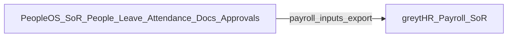
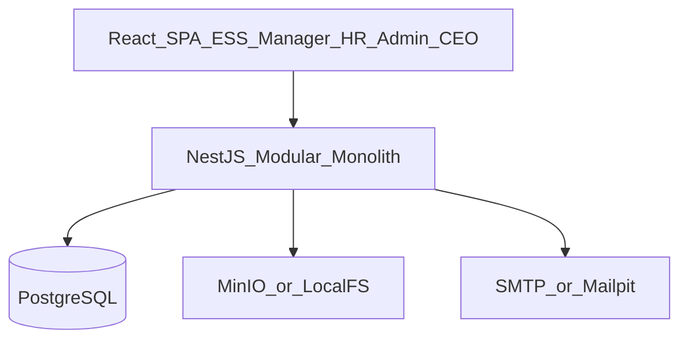
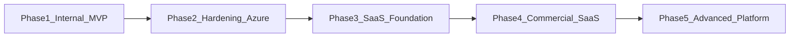

# PeopleOS — Management Overview

**Document type:** Management presentation pack (single narrative)  
**Audience:** CEO, Leadership, HR Head, Finance, IT  
**Product working name:** PeopleOS (internal HRMS)  
**Organization context:** ~500-employee India IT consultancy; current system **greytHR**; India-only for MVP  
**Recommendation:** **APPROVE WITH CONDITIONS** (see Section 8)  

**How to use this document:** Present Sections 1–8 in a management meeting. Use Section 9 links for depth. Full CEO approval conditions live in [01-executive-proposal.md](01-executive-proposal.md).

---

## Evidence labels

| Label | Meaning |
|-------|---------|
| **Fact** | Verifiable from company inputs or locked blueprint decisions |
| **Assumption** | Planning premise to validate with HR/IT in discovery |
| **Estimate** | Capacity or phase timing judgment — not a commercial contract |
| **Metric-to-measure** | Outcome to baseline and track after go-live (no invented ROI) |

---

## 1. Executive Snapshot

| Item | Decision |
|------|----------|
| **What we are building** | Internal Human Resource Management System (PeopleOS) |
| **Primary goal (12 weeks)** | Own Core HR, leave, attendance coordination, documents, approvals, ESS/Manager portals |
| **What we keep external** | Indian statutory **payroll** on greytHR (system of record for payroll) |
| **Team** | 4 engineers |
| **Initial delivery window** | 12 weeks / 3 months (**Fact** — hard constraint) |
| **Architecture** | Modular monolith: NestJS + React + PostgreSQL |
| **Infra — Stage A** | Target ₹0 paid cloud (Docker, OSS, free-tier CI) |
| **Infra — Stage B** | Azure after internal validation gates |
| **Long-term option** | Multi-tenant SaaS readiness via `tenant_id` — **not** commercial SaaS in MVP |
| **Management ask** | **APPROVE WITH CONDITIONS** |

---

## 2. What This Product Is About

### 2.1 Purpose

PeopleOS is an **owned digital people platform** for our company. It becomes the system of record for:

- Employee and organization master data  
- Leave and attendance coordination  
- Approval workflows  
- HR documents  
- Employee and manager self-service  
- Operational workforce reporting  

It is designed so that, after successful internal use, the same platform **can evolve** into a commercial multi-tenant SaaS product **without a rewrite** — while we deliberately **do not** fund commercial SaaS features in the first 12 weeks.

### 2.2 The problem it addresses

**Fact:** The company already runs **greytHR**.  
**Assumption (validate in Week 1):** Day-to-day friction remains in manager approvals, attendance corrections, document control, reporting for leadership, and process changes that wait on vendor configuration — often spilling into email and Excel.

| Stakeholder | What hurts today (**Assumption**) | What PeopleOS targets |
|-------------|-----------------------------------|------------------------|
| Employees | Unclear request status; multi-channel requests | Clear ESS: leave, attendance, documents, status |
| Managers | Approvals scattered; weak team visibility | Single approvals inbox + team views |
| HR | Side processes, limited change velocity | Owned workflows, audit, imports |
| Leadership | Manual headcount/attrition packs | Operational dashboards/reports |
| Finance | Leave/attendance inputs to payroll need clean handoff | Export/coordination to greytHR payroll |
| IT | Limited automation/API leverage | Versioned APIs, audit, controlled access |

### 2.3 What PeopleOS is — and is not

| PeopleOS **is** | PeopleOS **is not** (MVP) |
|-----------------|---------------------------|
| Internal HRMS for India IT consultancy (~500 employees) | A greytHR clone |
| System of record for people, leave, attendance ops, docs, approvals | A full Indian statutory payroll/tax engine |
| Modular monolith ready for later Azure and SaaS | Microservices / Kubernetes Day 1 |
| UX- and workflow-focused product | An AI-agent platform Day 1 |
| Compatible with keeping greytHR for payroll | A forced rip-and-replace of payroll in 12 weeks |

### 2.4 Relationship to greytHR

| Domain | System of record (MVP) |
|--------|-------------------------|
| Employee master, org structure | **PeopleOS** (after migration) |
| Leave / attendance coordination | **PeopleOS** |
| Documents / approvals / ESS | **PeopleOS** |
| Statutory payroll, payslips, PF/ESI/TDS filings | **greytHR** |

**Strategic honesty for management:** If the only objective were “run India payroll reliably,” continuing greytHR alone can be rational. Building PeopleOS is justified by **ownership, fit, UX/workflow control, APIs, auditability, and future product optionality** — not by beating greytHR at compliance payroll in three months.

---

## 3. Development Architecture

### 3.1 Architecture style

**Decision (locked):** **Modular monolith** — one NestJS application with clear domain modules; one React SPA; one PostgreSQL database.

| Choose | Avoid (MVP) |
|--------|-------------|
| Modular monolith | Microservices |
| Docker Compose locally | AKS / Kubernetes |
| Shared schema + `tenant_id` | Database-per-tenant Day 1 |
| Provider interfaces for auth/files | Hard Azure-only lock-in in core domain |

### 3.2 Technology stack

| Layer | Technology | Cost class (Stage A) |
|-------|------------|----------------------|
| Frontend | React + TypeScript + Vite | Open source |
| Backend | NestJS + TypeScript | Open source |
| ORM / migrations | Prisma | Open source |
| Database | PostgreSQL 16 | Open source (Docker) |
| API contract | OpenAPI / Swagger | Open source |
| Authentication | Local email/password + JWT access/refresh; MFA-ready | Open source |
| Authorization | RBAC + resource rules (self / manager chain / HR) | Built in-product |
| File storage | Local filesystem or MinIO | Open source |
| Email (dev) | Mailpit; company SMTP for pilot | OSS / existing |
| Cache (optional) | Redis | Open source |
| Containers | Docker + Docker Compose | OSS (verify Desktop licensing with IT) |
| CI/CD | GitHub Actions | **Free tier** (quota-limited — not unlimited) |
| Logging | Structured JSON logs (e.g. pino) | Open source |
| E2E testing | Playwright | Open source |

### 3.3 Logical view

**Module boundaries:** Identity · Core HR · Leave · Attendance · Workflow · Documents · Notifications · Reporting · Admin · Payroll integration (export only).

### 3.4 Stage A vs Stage B infrastructure

| Concern | Stage A — Development / Pilot | Stage B — Azure production (after gates) |
|---------|-------------------------------|------------------------------------------|
| Compute | Developer machines + optional internal VM | Azure Container Apps (preferred over AKS) |
| Database | PostgreSQL in Docker | Azure Database for PostgreSQL Flexible Server |
| Files | Local / MinIO | Azure Blob Storage (private) |
| Identity | Local JWT | Microsoft Entra ID (OIDC SSO) |
| Secrets | `.env` (git-ignored) | Azure Key Vault |
| Messaging | In-process events + outbox | Azure Service Bus when volume justifies |
| Monitoring | Structured logs (+ optional local Grafana) | Azure Monitor / Application Insights |
| Cash target | **₹0 paid cloud** wherever reasonable | Funded only after UAT + adoption gates |

**Fact:** Free tiers (e.g. GitHub Actions minutes) have **limits**. Exceeding quotas can block CI or require payment — plan self-hosted runners or throttled pipelines.

### 3.5 Security and tenancy (management view)

| Topic | Approach |
|-------|----------|
| Data sensitivity | HRMS holds PII and documents — security is first-class |
| Access control | Roles: Employee, Manager, HR, Admin, CEO (read dashboards) |
| Audit | Immutable audit events for sensitive actions |
| Multi-tenancy readiness | `tenant_id` on tenant-scoped tables from Day 1; single company tenant in MVP |
| Payroll data | Prefer **not** storing full payslip/statutory payroll in PeopleOS while greytHR remains payroll SoR |

---

## 4. Features

Priorities:

| Priority | Meaning |
|----------|---------|
| **P0** | Committed for 12-week MVP |
| **P1** | Stretch only if capacity remains after P0 hardening |
| **P2** | Explicitly deferred |

### 4.1 P0 — Must have (MVP)

| Area | Capabilities |
|------|----------------|
| **Identity & access** | Login, roles/permissions, session security, MFA-ready design |
| **Core HR** | Org units, departments, designations, locations, employee profiles, manager hierarchy, employment status, search |
| **Leave** | Policies/types, balances, apply/approve/reject, holidays, balance visibility in ESS |
| **Attendance** | Daily mark, CSV import hook (biometric export bridge), correction requests with approval, team views |
| **Workflow engine v1** | Sequential stages; role or reporting-manager approvers; unified inbox; **reminders** (escalation = P1) |
| **Documents** | Upload, version metadata, access control, audited download |
| **ESS** | Employee home: leave, attendance, docs, notifications |
| **Manager portal** | Approvals inbox, team leave/attendance |
| **Notifications** | In-app + email on submit/approve/reject |
| **Audit** | Searchable audit log for sensitive actions |
| **Reports** | Headcount, leave utilization, attendance summary, basic attrition |
| **Migration** | greytHR-oriented CSV/Excel import + reconciliation report |
| **Platform** | Docker Compose stack, OpenAPI, CI pipeline, structured logging |

### 4.2 P1 — Stretch (not promised)

| Feature | Why valuable |
|---------|----------------|
| Light ATS (requisition → candidate → status → offer draft) | Hiring visibility |
| Onboarding checklists | IT consultancy joiners |
| IT asset assignment (laptops) | High operational value for services firms |
| Simple HR helpdesk tickets | Reduce email chaos |
| Workflow escalation / delegation | Hardens approvals under load |

### 4.3 P2 — Deferred / will not build in MVP

- Full Indian statutory **payroll engine** (PF/ESI/PT/TDS/challans/Form 16 automation)  
- Performance / OKR suite, LMS, expenses engine  
- Native mobile apps, WhatsApp bots  
- AI agents / copilots as a product bet  
- Multi-country HR, commercial billing, SCIM marketplace  
- AKS / microservices “for enterprise optics”  
- Full biometric device cloud  

---

## 5. Team Members Required and Timeline

### 5.1 Core delivery team (4 engineers)

| Role | Primary ownership |
|------|-------------------|
| **Lead Developer / Solution Architect** | Architecture, ADRs, security baseline, critical reviews, stakeholder interface, scope control |
| **Backend Engineer** | NestJS modules, PostgreSQL/Prisma, workflow engine, APIs, integrations/exports |
| **Frontend Engineer** | React ESS / Manager / HR / Admin experiences, accessibility, UX fidelity |
| **Full-stack / QA Automation** | CI/CD, Docker, E2E/API tests, migration scripts, pilot deploy/ops |

**Assumption:** No dedicated Product Manager in the four — Lead + HR Head/HR Executive share requirements and UAT ownership.

### 5.2 Essential non-engineering stakeholders

| Role | Involvement |
|------|-------------|
| HR Head | Process owner, UAT sign-off, policy decisions |
| HR Executive | Day-to-day UAT, data cleansing, training support |
| Finance | Payroll handoff validation; cost baseline of current greytHR |
| IT | SMTP, pilot host VM, identity/email standards |
| CEO / sponsor | Go/No-Go, condition enforcement, Azure Phase 2 gate |

### 5.3 Capacity model (**Estimate**)

| Item | Value |
|------|-------|
| Gross capacity | 4 × 12 × 5 = **240 person-days** |
| Non-coding overhead (meetings, reviews, testing, docs, bugs) | ~35–40% |
| Effective build capacity | ~**145–155 person-days** |
| Contingency | ~15% → ~**127 commit-able** person-days for P0 |

This is why P0 is brutal and P1 is stretch-only.

### 5.4 Twelve-week delivery timeline

| Weeks | Focus | Outcome |
|-------|-------|---------|
| **1–2** | Discovery, PRD freeze, UX wireframes, ADRs, schema v1, greytHR export discovery | Scope locked |
| **3–4** | Foundation: auth, RBAC, audit, Docker, CI, migrations | Platform runnable |
| **5–7** | Core HR + Leave + Workflow engine | Core lifecycle working |
| **8** | Attendance + corrections + holidays | Attendance path live |
| **9–10** | ESS/Manager, Documents, Notifications, Reports | End-user portals usable |
| **11** | Security hardening, HR UAT, performance smoke, migration dry-run | Go/No-Go ready |
| **12** | Pilot go-live (subset of users), training, runbooks, KPI baseline | Controlled production pilot |

**Critical path:** Requirements freeze → Auth/RBAC → Employee master → Leave + Workflow → ESS approvals → Migration dry-run → Pilot. Slip on leave/workflow endangers the date.

### 5.5 Sprint shape

Assume **2-week sprints** (Sprint 0 discovery through Sprint 6 pilot). Weekly demos to HR Head; scope changes require written trade-offs against P0.

---

## 6. Phasewise Timeline Roadmap (Development → Production → Beyond)

Horizon below mixes the **12-week MVP** with the **12–24 month** product roadmap. Phase durations outside the 12-week window are **Estimates**, not contracts.

### Phase 1 — Internal HRMS MVP (Months 0–3)

| | |
|--|--|
| **Objective** | Ship P0; employees/managers/HR run leave, attendance, core HR, documents, approvals on PeopleOS |
| **Environment** | Stage A: Docker / OSS / free-tier CI; pilot on existing company VM preferred |
| **Payroll** | Remains on greytHR |
| **Exit criteria** | UAT signed; migration dry-run accepted; no Sev-1 authz/data leaks; payroll export path works; pilot cohort live |

### Phase 2 — Enterprise hardening and production Azure (Months ~3–9) (**Estimate**)

| | |
|--|--|
| **Objective** | Company-widerollout readiness; production-trustworthy ops |
| **Build** | Azure Container Apps + Azure PostgreSQL + Blob + Key Vault + Monitor; MFA for privileged roles; backup/restore drills; stronger workflows (delegation/escalation); richer reports; selected P1 (e.g. assets) |
| **Still not** | External multi-tenant billing, marketplace, AI platform bet |
| **Exit criteria** | Security baseline signed; runbooks exist; Azure (or approved prod) RPO/RTO agreed; adoption metrics reviewed |

### Phase 3 — SaaS foundation (Months ~9–14) (**Estimate**)

| | |
|--|--|
| **Objective** | Technical multi-tenant readiness for *possible* commercialization |
| **Build** | Enforce tenant isolation tests; feature flags; admin APIs; webhook groundwork; SSO packaging design |
| **Still not** | Self-serve signup + billing as a forced MVP of SaaS |

### Phase 4 — Commercial SaaS (Months ~14–20) (**Estimate**)

| | |
|--|--|
| **Objective** | External customers only **after** internal proof |
| **Build** | Tenant onboarding, subscription/billing, commercial SLAs, partner payroll integrations, support model |
| **Gate** | Separate investment case — not automatic |

### Phase 5 — Advanced platform (Months ~20–24+) (**Estimate**)

| | |
|--|--|
| **Examples** | Advanced analytics, localization depth, marketplace, carefully validated AI assistance |
| **Rule** | Fund only with evidence of demand and data quality |

### Production path (simplified)

| Stage | Where it runs | When |
|-------|---------------|------|
| Development | Local Docker Compose | Weeks 1–11 |
| Pilot production | Existing org VM / controlled host | Week 12 |
| Enterprise production | Azure (Stage B) | After Phase 1 exit + budget approval |
| Multi-tenant SaaS production | Azure hardened + tenancy ops | Phase 4+ |

---

## 7. Future Updates

### 7.1 Near-term (immediately after MVP — if capacity/priority allows)

1. Workflow escalation and delegation  
2. IT asset tracking  
3. Onboarding checklists  
4. Light recruitment pipeline  
5. HR helpdesk tickets  
6. Stronger reporting packs for CEO/HR  

### 7.2 Medium-term (hardening / Azure)

1. Entra ID SSO and stronger MFA policy  
2. Azure managed database, blob, monitoring, Key Vault  
3. Improved backup/DR drills  
4. Deeper greytHR (or successor) payroll integration automation  
5. Document retention and e-sign integration (**integrate**, don’t build)  

### 7.3 Long-term (SaaS optionality)

1. True multi-tenant commercial operations  
2. Billing and subscriptions (**only when commercializing**)  
3. Public developer APIs / webhooks  
4. Custom fields and branding for tenants  
5. Regional compliance packs beyond single India entity  

### 7.4 What management should **not** fund early

| Premature investment | Why wait |
|----------------------|----------|
| Full payroll engine | High complexity/compliance; greytHR already strong |
| AI agents as headline | Needs clean data + stable workflows first |
| Microservices / AKS | Ops cost exceeds benefit for 4-person team at ~500 users |
| Billing / marketplace | Distracts from internal adoption proof |
| Native mobile + WhatsApp Day 1 | Responsive web covers MVP; native is a later product line |

---

## 8. Management Ask / Recommendation

### Recommendation

# APPROVE WITH CONDITIONS

### Conditions (non-negotiable)

1. **P0 scope freeze** as listed in Section 4.1; P1 only with Lead confirmation of spare capacity.  
2. **No statutory payroll engine** in the 12-week program.  
3. **greytHR remains payroll system of record** until an explicit Phase 2 decision.  
4. **Azure spend gated** on UAT pass + pilot adoption thresholds (define in Weeks 1–2).  
5. **Security review + backup/restore drill** before company-wide rollout.  
6. **Weekly demos** to HR Head; scope changes require written trade-offs.  
7. **Success metrics baselined** in Weeks 1–2; 90-day review with CEO.

### Metrics to measure (no invented ROI)

| Area | Metric-to-measure |
|------|-------------------|
| Adoption | % employees monthly active on ESS |
| Self-service | % leave requests in-system (not email) |
| Speed | Median leave approval time |
| HR load | Hours/week on Excel consolidations / corrections |
| Quality | % employees with complete mandatory profile fields |
| Trust | Sensitive actions with audit events; Sev-1 incidents |
| Leadership | Time to produce monthly headcount/attrition pack |

### If conditions are rejected

**Do not approve** a full platform build. Instead run a short discovery + buy/switch evaluation (deepen greytHR vs alternatives) without engineering a new SoR.

---

## 9. Appendix — Where to Read More

| Topic | Document |
|-------|----------|
| Full CEO approval pack | [01-executive-proposal.md](01-executive-proposal.md) |
| Market and competitive logic | [02-market-analysis.md](02-market-analysis.md) |
| Product vision | [03-product-vision.md](03-product-vision.md) |
| Detailed MVP PRD | [05-product-requirements-mvp.md](05-product-requirements-mvp.md) |
| System architecture | [10-system-architecture.md](10-system-architecture.md) |
| Zero-cost stack | [18-zero-cost-architecture.md](18-zero-cost-architecture.md) |
| Azure target | [19-azure-target-architecture.md](19-azure-target-architecture.md) |
| 12-week plan / team R&R | [24-project-plan-12-weeks.md](24-project-plan-12-weeks.md) |
| Sprint plan | [25-sprint-plan.md](25-sprint-plan.md) |
| Risks | [23-risk-register.md](23-risk-register.md) |
| SaaS roadmap | [28-saas-roadmap.md](28-saas-roadmap.md) |
| Final decisions A–L | [appendices/part-48-final-recommendation.md](appendices/part-48-final-recommendation.md) |
| Doc index | [00-README.md](00-README.md) |
| Quick-share artifact | [../artifacts/31-management-overview/brief.html](../artifacts/31-management-overview/brief.html) |

---

**Document control:** Synthesized from the PeopleOS enterprise blueprint. Locked decisions above must not be reopened casually during the 12-week program.
