# 33 — Implemented workflow catalog

**Product:** PeopleOS  
**Status:** Inventory of the running app. Not a target design.  
**Last updated:** 2026-10-05  
**Related:** [08-process-flows](08-process-flows.md) (intended process) · [06-srs-functional](06-srs-functional.md) · [Progress.md](../Progress.md)

This catalog lists every workflow that exists in `apps/web`, `apps/api`, and `apps/mobile`. [08-process-flows](08-process-flows.md) names the process the product is meant to have. Where that document and the code disagree, this file follows the code. Specified processes that are missing or only mocked are listed at the end and are not drawn as built.

---

## 1. How to read this catalog

A workflow is a multi-step handoff a person starts, continues, or finishes: apply, approve, reject, withdraw, upload, assign a role, reset a password, raise a ticket, and the same kind of step. Happy paths and the branches that exist in code are both included.

| Maturity | Meaning |
|----------|---------|
| **Live** | Persisted through the API and Postgres. Survives a reload. |
| **Session mock** | Works in the UI. Stored only in browser state for this session. |
| **Static** | A screen or list with no real state change. |
| **Specified only** | Described in `docs/` and not present in `apps/`. |

Two browser stores sit in front of almost every HR screen. Neither is the database.

- ESS state is `useState` inside `EssDataProvider`, mounted only under `/ess` (`apps/web/src/ess/components/EssLayout.tsx`). Leaving `/ess` or reloading restores `createInitialEssState()`.
- Manager, HR, and admin workspace state is a module variable in `apps/web/src/workspace/workspaceMock.ts` (lines 130–186). It survives in-tab navigation and dies on a full reload. It is not keyed by user. `useWorkspace` shows an inbox row only when `item.approverId === me.id` (lines 214–218).

Postgres holds tenants, users, roles, permissions, refresh tokens, password-reset OTPs, and audit events. There is no employee, leave, attendance, document, ticket, or workflow model. `/hr/workflows` renders the constant `workflows` array (three names, hardcoded `stuck` counts) in `workspaceMock.ts` lines 93–97. There is no workflow engine.

**Approver rule, as coded.** `approverFor` in `apps/web/src/ess/mock/essMock.ts` lines 994–1001: if the person has a `teamId` and is not that team's manager, the approver is `teams[].managerId`. Otherwise it is `person.managerId`. The demo employee resolves to Rohit Mehta (`p-002`). A manager's own request resolves to Priya Nair (`p-010`), who is not a login, so that row is in nobody's inbox. HR can see pending counts and cannot decide them.

`EMPLOYEE` and `HR_EXEC` have empty permission lists in `ROLE_PERMISSION_MATRIX` (`apps/api/prisma/seed.ts`). That is the seed. `HR_EXEC` and `HR_HEAD` share every HR nav section. Their permissions differ, and those extra permissions do not open a different screen.

---

## 2. Role and responsibility matrix

Nav comes from `navSectionsForUser` in `apps/web/src/layout/appNav.ts`. An empty `roles` array on a section means every signed-in user sees it. Route gates are in `apps/web/src/App.tsx`. Permissions are `ROLE_PERMISSION_MATRIX`.

| Role | Navigation | Routes | Permissions | Actions |
|------|------------|--------|-------------|---------|
| EMPLOYEE | Overview, Time, Pay, Workplace, Account, Support | `/ess/*` | None | ESS self-service, password change, auth |
| MANAGER | ESS plus Approvals, team Time, Directory | `/ess/*`, `/manager/*` | `reports.read` (never checked) | Inbox approve and reject, plus own ESS |
| HR_EXEC | ESS plus all HR sections, shared with HR_HEAD | `/ess/*`, `/hr/*` | None | Add a directory person, record a fake import. Cannot approve |
| HR_HEAD | Same nav and buttons as HR_EXEC | `/ess/*`, `/hr/*` | `rbac.read`, `audit.read`, `reports.read` (none open a screen) | Same as HR_EXEC. No seed user |
| FINANCE_READ | No finance section. Ungated ESS still shows | `/ess/*` only | `reports.read` (never checked) | No finance flow. Inherited ESS and auth only |
| IT_ADMIN | ESS plus Access and Platform | `/ess/*`, `/admin/*` | `rbac.assign`, `rbac.read`, `identity.manage` (`identity.manage` unused) | Replace roles, toggle settings. Audit page is static |
| SECURITY_ADMIN | Same admin nav as IT_ADMIN | `/ess/*`, `/admin/*` | IT set plus `audit.read` (never checked) | Same admin actions. Last holder cannot be removed |
| LEADERSHIP_READ | ESS plus Leadership | `/ess/*`, `/exec/*` | `audit.read`, `reports.read` (neither checked) | Read four figures. Seeded on `hr@` |

Seeded users: `admin@` is `SECURITY_ADMIN`. `employee@` is `EMPLOYEE`. `manager@` is `MANAGER` plus `EMPLOYEE`. `hr@` is `HR_EXEC` plus `EMPLOYEE` plus `LEADERSHIP_READ`.

### UI and API mismatches

| Surface | Who the UI allows | What the API enforces |
|---------|-------------------|------------------------|
| HR screens | `HR_EXEC` or `HR_HEAD`, else redirect to `/ess` | No employee, leave, or attendance API |
| Manager inbox | `MANAGER` | No approval API. `decide` only mutates the module inbox |
| `/admin/audit` | `IT_ADMIN` and `SECURITY_ADMIN` | `audit.read` is never checked. No audit query route |
| HR_HEAD and LEADERSHIP_READ | Cannot open `/admin/audit` | Both hold `audit.read`, which nothing reads |
| `/admin/roles` | Admin role and `rbac.assign`, else redirect to `/ess` | `PUT /users/:id/roles` returns `403 Insufficient permissions` |
| System settings | `IT_ADMIN` and `SECURITY_ADMIN` toggles | `identity.manage` is never checked. Flags are in memory |
| `reports.read` | Not used to show Reports | No reports controller |

A missing role or a missing `rbac.assign` redirects to `/ess` (`apps/web/src/auth/ProtectedRoute.tsx`). There is no 403 page. The only `403 Insufficient permissions` is `PUT /api/v1/users/:id/roles`.

---

## 3. RACI

R is responsible, A is accountable, I is informed. A blank cell means the role is uninvolved. Consulted is unused: no screen asks another role. Informed is set only where a toast, an in-app row, or an email actually fires.

Password-reset mail informs the account owner. Leave and correction toasts are session mock, so Informed is that same person in the session, not email, and not HR or leadership. Manager is blank on apply and correction because `decide` does not notify them, and the inbox row is the same browser store. HR is blank on documents: the workflows page names HR and does not give them an action.

Finance, IT, Security, and Leadership match Employee on ESS rows because those screens are ungated. Their extra roles add no ESS permission. Employee self-service stays off the Manager column even when one person holds both roles.

| Workflow | Emp | Mgr | HR Exec | HR Head | Fin | IT | Sec | Lead |
|----------|-----|-----|---------|---------|-----|----|-----|------|
| Sign in | R | R | R | R | R | R | R | R |
| Refresh | R | R | R | R | R | R | R | R |
| Sign out | R | R | R | R | R | R | R | R |
| Forgot-password OTP | R/I | R/I | R/I | R/I | R/I | R/I | R/I | R/I |
| Change password | R/A | R/A | R/A | R/A | R/A | R/A | R/A | R/A |
| Replace roles | | | | | | R/A | R/A | |
| Apply leave | R/I | | | | R/I | R/I | R/I | R/I |
| Withdraw leave | R/A | | | | R/A | R/A | R/A | R/A |
| Approve or reject | | R/A | | | | | | |
| Mark attendance | R/A | | | | R/A | R/A | R/A | R/A |
| Attendance correction | R/I | | | | R/I | R/I | R/I | R/I |
| Upload document | R/I | | | | R/I | R/I | R/I | R/I |
| Helpdesk ticket | R | | | | R | R | R | R |
| Add employee | | | R/A | R/A | | | | |
| Record import | | | R/A | R/A | | | | |
| Toggle system flags | | | | | | R | R | |
| Read leadership figures | | | | | | | | R |

---

## 4. Live auth and access

### 4.1 Sign in

**Live.** An anonymous person submits `/login` and lands on `/ess` with tokens.

An already signed-in user is redirected to `/ess`. The form uses `noValidate`, so browser `required` and `minLength` do not run. The API requires an email and a password of at least 8 characters.

`LoginPage.onSubmit` calls `POST /api/v1/auth/login`. Unknown, disabled, and wrong-password users all get `401 Invalid email or password`. Success writes a `RefreshToken` and stores `peopleos_access` and `peopleos_refresh` in `sessionStorage`. No `AuditEvent`. Progress T-012 says login writes one. `AuthService.login` (`apps/api/src/auth/auth.service.ts` lines 28–45) does not.

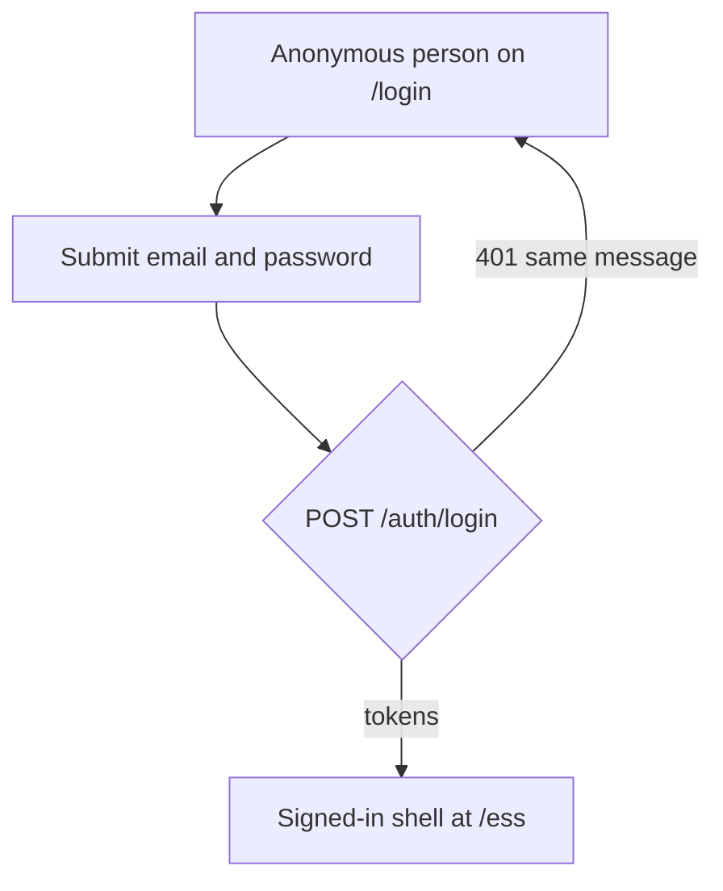

### 4.2 Refresh

**Live.** The web and Expo clients call `POST /api/v1/auth/refresh` after a `401`. The old refresh row is revoked and a new one is inserted. Roles on the new access token are re-read from the database. Missing, expired, or inactive users get `401 Invalid refresh token`. No audit and no email.

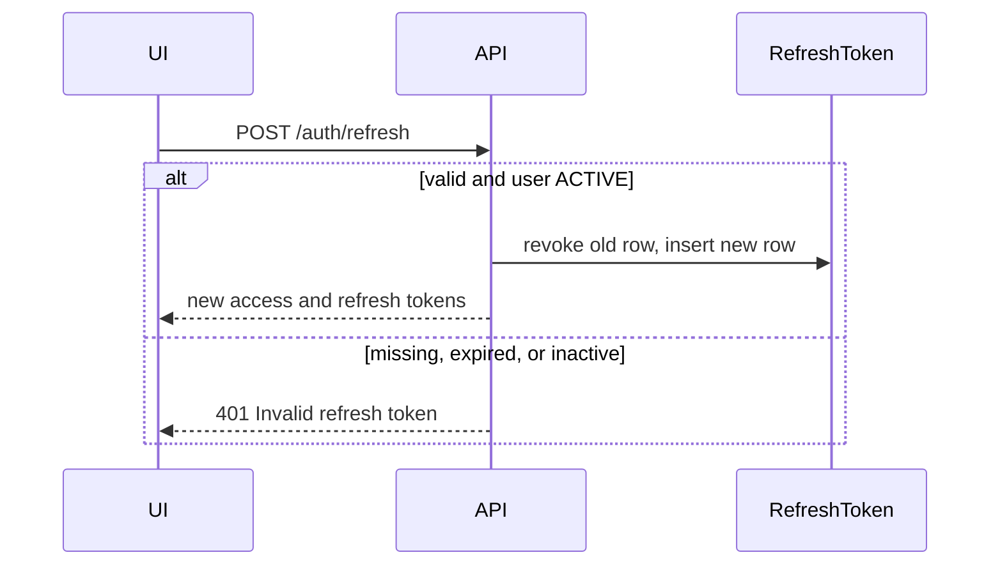

### 4.3 Sign out

**Live.** The header menu calls `POST /api/v1/auth/logout`, which sets `revokedAt` on the matching refresh row. An unknown token still returns success. API errors are swallowed and the browser tokens are cleared anyway. The access JWT is not revoked. No audit.

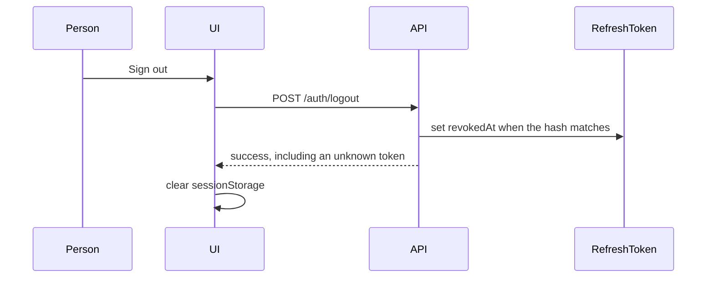

### 4.4 Forgot-password OTP

**Live.** Anonymous person, three routes. This is the only product email (`MailService.sendPasswordResetOtp`).

1. `/forgot-password` rejects a blank email with `Work email is required.`, then `POST /api/v1/auth/password-reset/request`. Unknown or inactive users get the same success sentence and no write. A second request inside 60 seconds is `400 Please wait before requesting another code.` A 6-digit OTP is stored hashed, expires in 10 minutes, and is emailed. A send failure is logged and swallowed. The OTP row remains.
2. `/forgot-password/otp` requires the email in router state, or it redirects back. The code must be 6 digits. Failures are `400 Invalid or expired code.` Five bad attempts consume the row. Success returns a reset token held only in router state for 15 minutes.
3. `/forgot-password/reset` requires that token, a password of at least 8 characters, and a matching confirmation. The new password must differ from the current one. Confirm writes `User.passwordHash`, revokes refresh tokens, clears the reset session, and writes `AuditEvent` `auth.password.reset`. It does not issue tokens. The login page then shows `Password updated. Sign in with your new password.`

The wizard state does not survive a reload. The new password does.

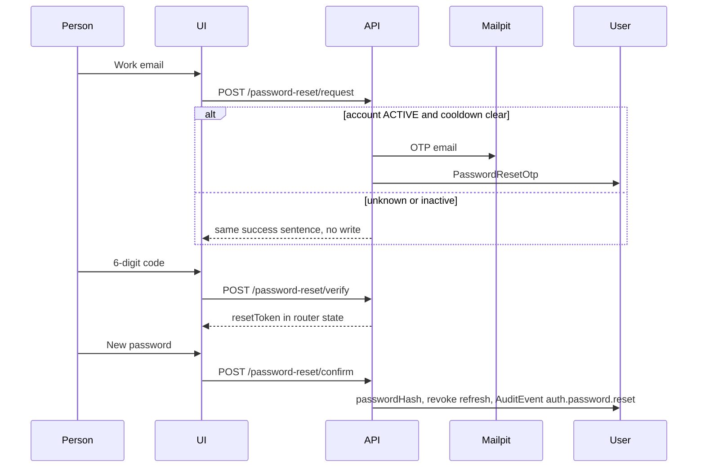

### 4.5 Change password

**Live.** Any signed-in person on `/ess/settings`. The page rejects a password shorter than 8 characters, a mismatch, and a password equal to the current one. `POST /api/v1/auth/password/change` checks the current password (`401 Current password is incorrect.`), writes the hash, revokes other refresh tokens, writes `AuditEvent` `auth.password.change` (`auth.service.ts` line 130), and returns new tokens. The page says other devices must sign in again. No email.

Start: `EssSettingsPage.onSubmit` (`apps/web/src/ess/pages/EssSettingsPage.tsx` lines 19–49).

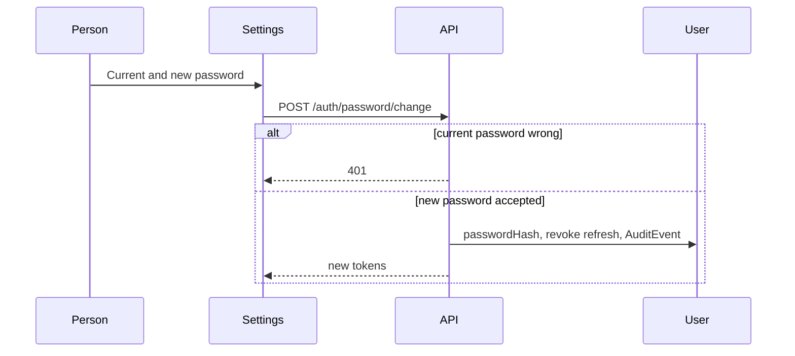

### 4.6 Replace roles

**Live.** `IT_ADMIN` or `SECURITY_ADMIN` with `rbac.assign`, on `/admin/roles`. There is no separate revoke route. `PUT /api/v1/users/:id/roles` replaces the set. The save button stays disabled while the draft is empty. The API also rejects an empty list, an unknown code, and a user outside the tenant (`404`). Removing the last active `SECURITY_ADMIN` returns `403 Cannot remove the last SECURITY_ADMIN with rbac.assign in this tenant`. The check counts that role, not the permission. Success writes `UserRole` rows and `AuditEvent` `rbac.roles.update` with `previousRoles` and `nextRoles` (`apps/api/src/rbac/rbac.service.ts` line 109). No email. The message is `Updated roles for ${email}`.

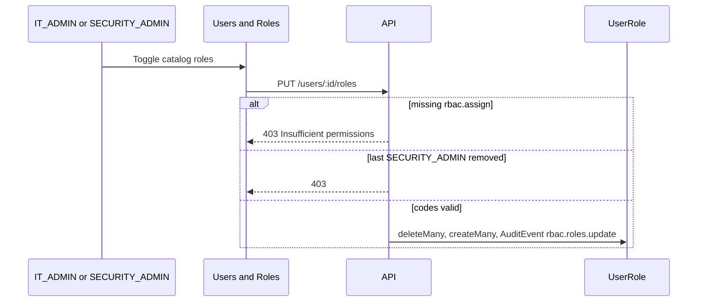

---

## 5. Employee self-service

These screens are on every signed-in user's nav, including a person who only holds `FINANCE_READ`. They are still employee actions. A manager's own requests use this lane, not the inbox lane.

### 5.1 Apply leave

**Session mock.** Progress T-016. Route `/ess/leave`. Start: `EssLeavePage.onSubmit` (`apps/web/src/ess/pages/EssLeavePage.tsx` lines 73–94). Decision and write: `applyLeave` (`apps/web/src/ess/mock/EssDataContext.tsx` lines 141–227) and `submitApproval` (`workspaceMock.ts` lines 200–205).

Errors that write nothing: unknown type, missing dates, end before start, blank reason, no working days, and, unless the type is `LOP`, `Only ${available} day(s) available for ${type}.` Weekends and holidays are skipped. A same-day half day counts as 0.5. There is no overlap check, no past-date ban, no attachment, and no locked period.

On success the ESS row is `Pending`, non-LOP `pending` balance increases, a notification `Leave submitted` is inserted, and, when both the person and an approver exist, `submitApproval` adds an inbox row. Toast: `Leave request sent to ${name}.` If there is no approver, the ESS row still exists and the inbox does not. Lost on reload. No audit and no email.

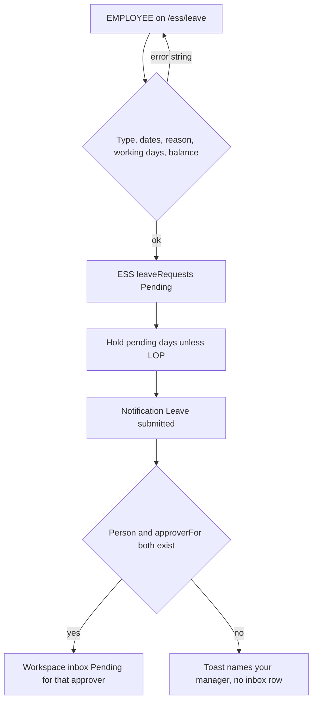

### 5.2 Withdraw leave

**Session mock.** The Withdraw button is shown only when the overlay status is `Pending` (`EssLeavePage.tsx` around line 249). `withdrawLeave` (lines 231–248) always sets the inbox row to `Withdrawn` first. It then updates the ESS row and releases the hold only if that ESS row is still `Pending`. LOP does not change the balance. Toast: `Leave request withdrawn.` No confirmation dialog. Attendance corrections have no withdraw.

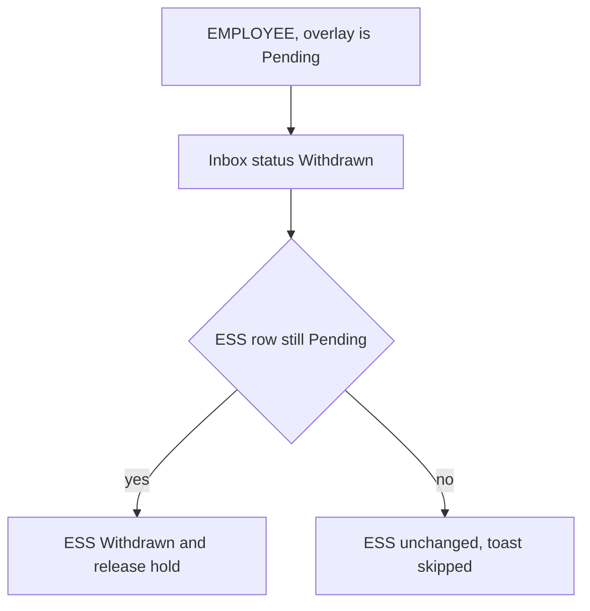

### 5.3 Mark attendance

**Session mock.** Progress T-020. Same mutator, two entries.

`/ess/attendance` enables the button only for demo day `2026-09-29` when that day is not already `Present` (`EssAttendancePage.tsx` line 492). `/ess` home calls `markAttendance` with today's real date and no such guard (`EssHomePage.tsx` lines 231 and 240).

`markAttendance` (lines 250–268) refuses `Present`, `Holiday`, `Weekend`, `Leave`, and `PendingCorrection`. `Absent` or a missing day becomes `Present` with the current time as check-in. Toasts are `Already marked present for today.`, `Cannot mark attendance on a ${status} day.`, or `Attendance marked at ${time}.` No approver and no inbox row.

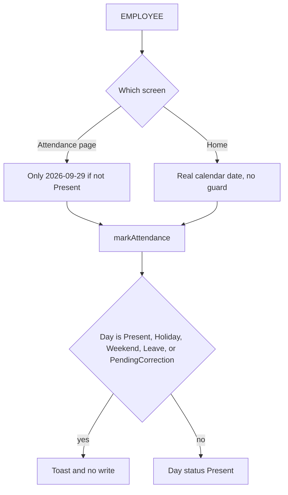

### 5.4 Request an attendance correction

**Session mock.** Progress T-022. `/ess/attendance`. `requestCorrection` (lines 292–358). Requires a date and a reason. A second `Pending` correction on the same date returns `A correction is already pending for this date.` The requested status is only `Present` or `Absent`. Cancel closes the form and writes nothing.

Success writes an ESS correction `Pending`, sets that attendance day to `PendingCorrection`, inserts a notification `Correction requested`, and calls `submitApproval` with `kind: 'Attendance'` when an approver exists. Toast names the approver. No withdraw, no overlap check, no locked period. Lost on reload.

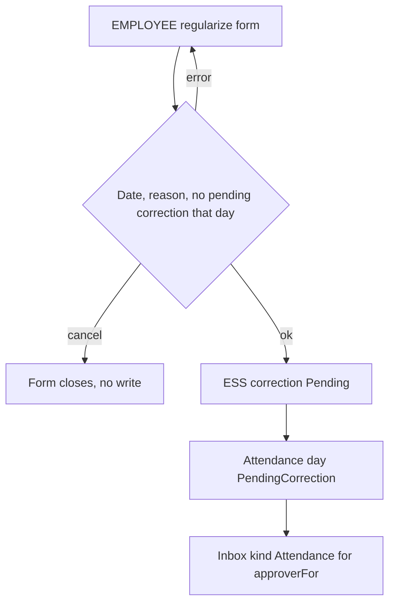

### 5.5 Upload a document

**Session mock.** Progress T-025. `/ess/documents`. A blank name returns immediately. The file bytes are not read. `uploadDocument` (lines 365–390) adds `owner: 'mine'`, size `—`, a notification `Document uploaded`, and the toast `Document uploaded (mock).` No approver.

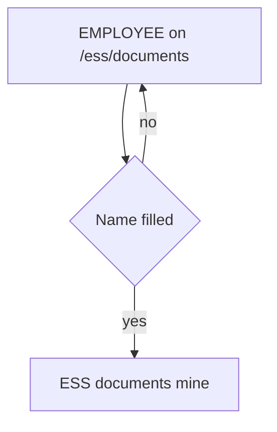

### 5.6 Download a document

**Static.** `onDownload` sets a local string, `Download started for ${name} (mock).`, for 2.5 seconds. No file and no store write.

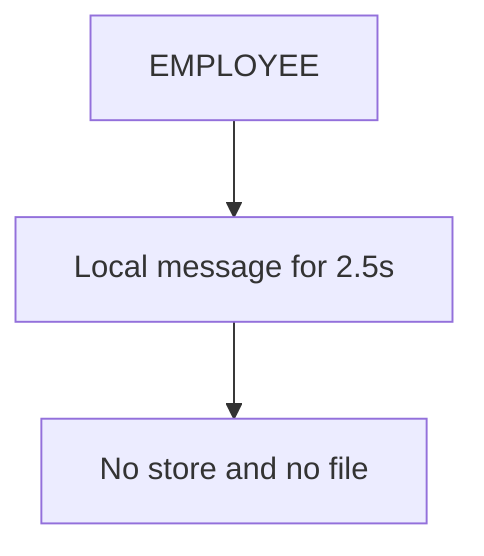

### 5.7 Create a helpdesk ticket

**Session mock.** Progress T-045. `/ess/helpdesk`. `EssHelpdeskPage.onSubmit` (lines 11–16) and `createTicket` (lines 393–405). A blank subject returns. The new status is `Open`. Categories are Payroll, Leave, Attendance, and Access. There is no assignee and no transition to `In progress` or `Resolved`. Seed ticket `t-1` is already `In progress`. Toast: `Ticket submitted.` No notification and no HR queue.

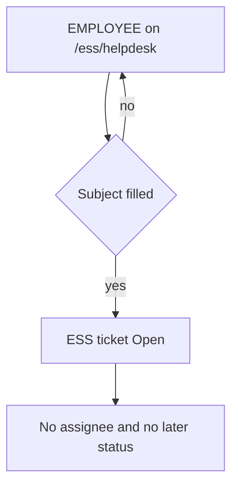

### 5.8 Mark notifications read

**Session mock.** Progress T-026. `/ess/notifications`. One id sets `read: true` with no toast (`markNotificationRead`, lines 416–422). Mark all sets every row read and toasts `All notifications marked read.` The button is disabled when the unread count is 0. Home links do not mark read.

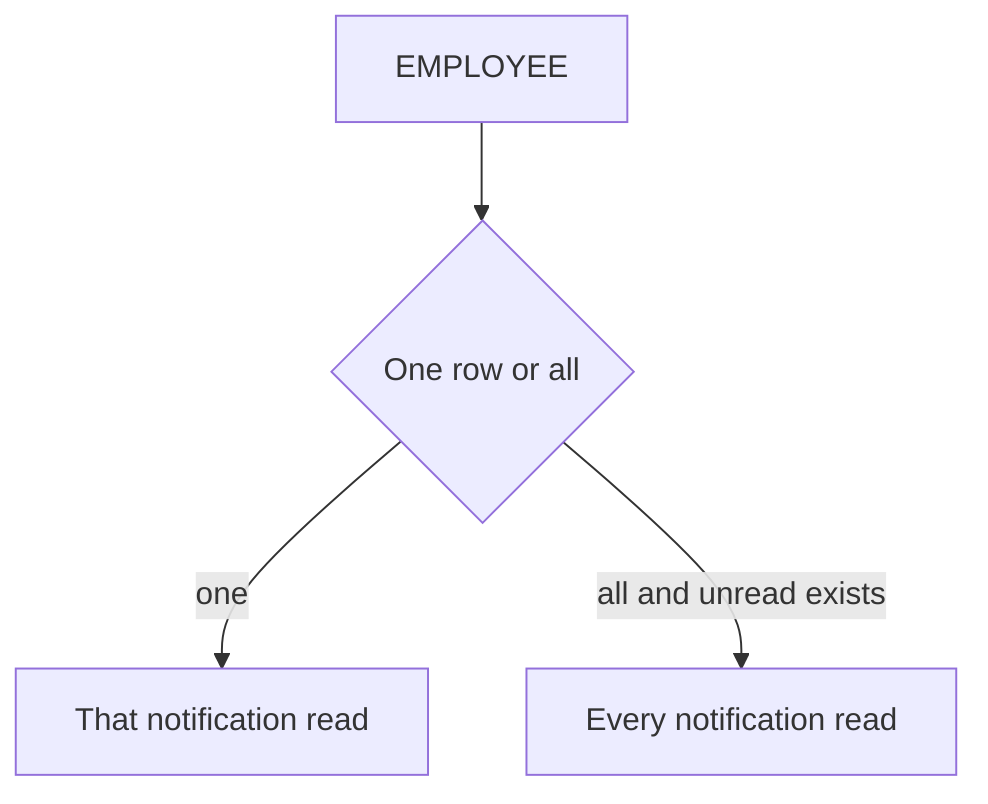

### 5.9 Mask salary, sample CSV, theme, sidebar

Mask salary is `sessionStorage` key `peopleos-salary-hidden`. It survives a reload of that tab and is lost when the tab closes. Default is hidden.

Payslip and YTD downloads build a client CSV of sample figures. The salary page says they are not payroll amounts. App state does not change. **Static.**

Theme (`peopleos-theme`) and sidebar collapse (`peopleos-sidebar-collapsed`) are device `localStorage`. They are preferences, not HR workflows.

### 5.10 Read-only ESS

**Static.** `/ess/people`, `/ess/people/:id`, `/ess/team`, `/ess/profile`, leave balances, and the holiday calendar do not write ESS or workspace state. My Team lists the signed-in person's own pending inbox rows and does not approve them. `updateContacts` would toast `Contact details saved.` and no page calls it. Profile stays read-only.

---

## 6. Manager decisions

Kept separate from the employee lane, even though the seed manager is `MANAGER` plus `EMPLOYEE`.

### 6.1 Approve or reject

**Session mock.** Progress T-018. `/manager/inbox`. `ManagerInboxPage` (`apps/web/src/workspace/RolePages.tsx` lines 72–110). Buttons render only when `item.status === 'Pending'`. `decide` (`workspaceMock.ts` lines 239–241) calls `setApprovalStatus` (lines 207–212). It does not check `approverId` again, because the list is already `myInbox`. Reject takes no reason.

The inbox status becomes `Approved` or `Rejected`. It does not update the ESS leave row, move `pending` balance to `used`, clear `PendingCorrection`, write `decidedAt` or `decisionNote`, notify, toast, email, or audit. While `/ess` is still mounted, the leave and attendance cards copy the inbox status for display. Home does not. It keeps listing ESS rows whose status is `Pending`.

Seed rows include `lr-2` and `cr-1` for Rohit, plus Kabir's leave. `tl-3` is pending for Meera Iyer, who is not a login. `lr-6` is a pending work-from-home request in ESS and is not in the inbox.

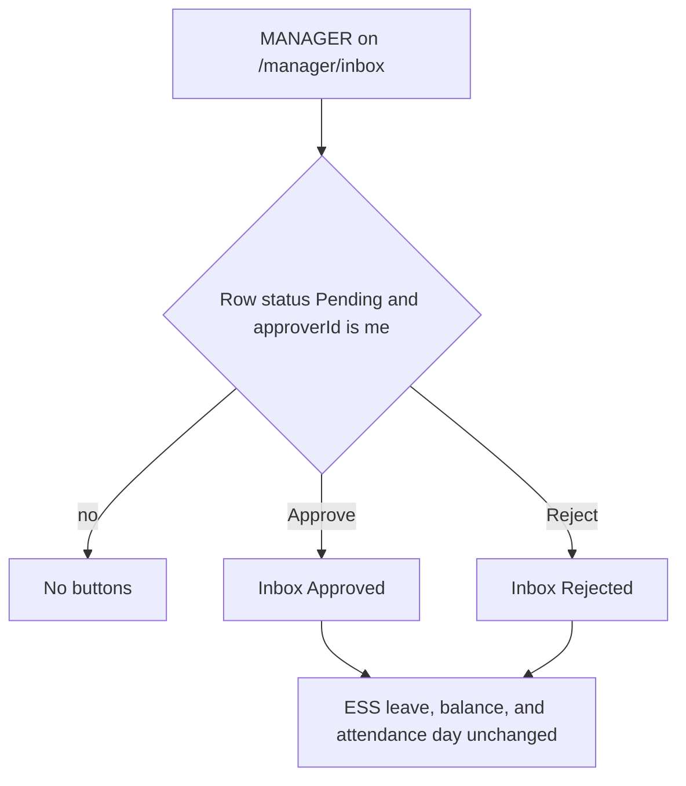

Team overview, team leave, team attendance, and team directory only read this slice. `teamExceptions` is a constant and never updates. No decide buttons. **Static**, aside from reflecting an inbox decision made in the same session.

---

## 7. HR Executive and HR Head

Same nav, same buttons. Neither can approve.

### 7.1 Add an employee

**Session mock.** Progress T-014. `/hr/employees`. A blank name returns. `addEmployee` (`workspaceMock.ts` lines 242–266) prepends a workspace person. Unknown departments fall through to Engineering. Empty title becomes `New joiner`. Empty location becomes `Noida`. The email is derived from the name. The manager is that department's first team manager. No `User`, no `EMPLOYEE` grant, no invite email, no toast. The ESS directory is a separate copy and does not show this person. Lost on reload.

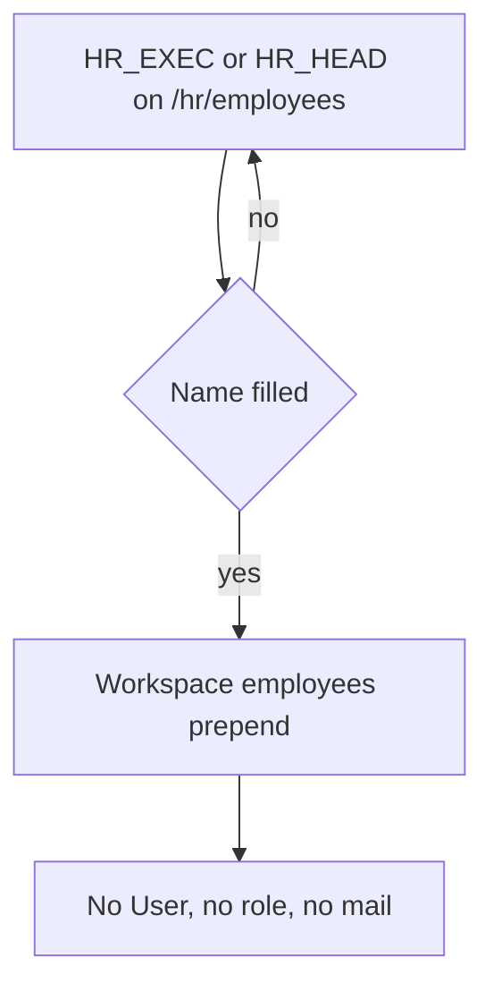

### 7.2 Record an import

**Session mock.** Progress T-021 and T-028. Attendance admin calls `addImport('attendance-september.csv')` and the page says it does not read a file. Migration submits a name, default `greytHR-employees.csv`, and ignores a blank name. Both use `addImport` (lines 267–279), which always stores `rows: 12`. No toast. Lost on reload.

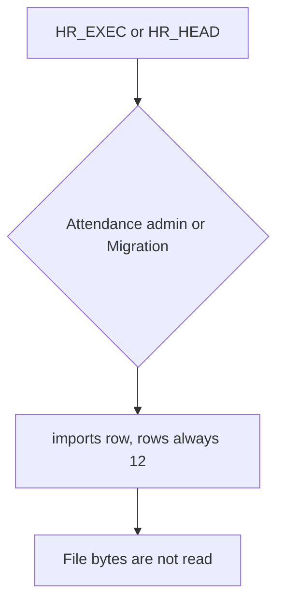

### 7.3 Static HR screens

Organization, leave types, company documents, and reports do not mutate policy or people. Reports use four figures, and the awaiting-approval count is `workspace.pending.length` for every approver. `HrWorkflowsPage` (`RolePages.tsx` lines 529–556) sums the hardcoded `stuck` values (2, 1, and 0) and renders no actions. Document verification names HR and performs nothing.

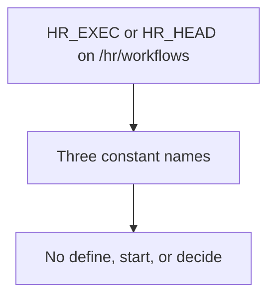

---

## 8. IT Admin and Security Admin

### 8.1 Toggle system flags

**Session mock.** Progress T-019. `/admin/settings`. `toggleSetting` (`workspaceMock.ts` lines 281–283). Flags are `smtp`, `retention`, and `reminders`. Seed is on, on, and off. No API, no toast, and the jobs list does not change.

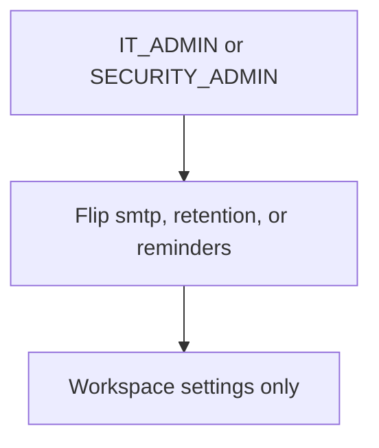

### 8.2 Static admin screens

Audit log, mail health, and jobs are seed arrays. Signing in, approving leave, and resetting a password do not append to `auditLog`. Real audit rows have no query API. Jobs (`Leave reminders`, `Escalations`, `Payroll export`) cannot be run.

---

## 9. Leadership

**Static.** Progress T-027. `/exec` and `/exec/reports` show the same four figures. The overview says read only. No write.

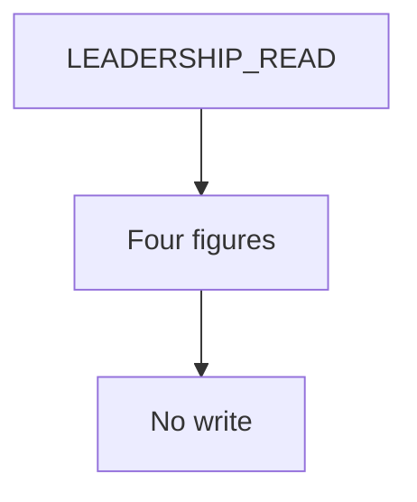

---

## 10. Mobile

**Expo, mixed.** Login, refresh, logout, and `GET /auth/me` are live (`apps/mobile/src/app/login.tsx` and `apps/mobile/src/app/(tabs)/more.tsx`). Home, leave, attendance, people, profile, documents, and notifications render `essData` and cannot apply, withdraw, mark, upload, or open a ticket.

```mermaid
flowchart TD
  expo["Expo"] --> live["Login, refresh, logout against API"]
  expo --> view["ESS tabs view essData"]
```

---

## 11. Cross-role handoffs

Participants below are only the layers that exist.

### 11.1 Leave

```mermaid
sequenceDiagram
  participant Emp as EMPLOYEE
  participant ESS as ESS state
  participant Inbox as Workspace inbox
  participant Mgr as MANAGER
  Emp->>ESS: applyLeave Pending
  ESS->>Inbox: submitApproval when approverFor exists
  Mgr->>Inbox: Approve or Reject
  Note over ESS: ESS status and balance stay as submitted
  Emp->>Inbox: Withdraw sets Withdrawn
  Inbox-->>ESS: ESS updates only if that row is still Pending
```

### 11.2 Attendance correction

```mermaid
sequenceDiagram
  participant Emp as EMPLOYEE
  participant ESS as ESS state
  participant Inbox as Workspace inbox
  participant Mgr as MANAGER
  Emp->>ESS: correction Pending, day PendingCorrection
  ESS->>Inbox: kind Attendance
  Mgr->>Inbox: Approve or Reject
  Note over ESS: Day stays PendingCorrection
```

### 11.3 Documents

```mermaid
sequenceDiagram
  participant Emp as EMPLOYEE
  participant ESS as ESS documents
  Emp->>ESS: upload name only
  Note over Emp: Download shows a local message
  Note over Emp: HR document verification is a label with no step
```

### 11.4 Helpdesk

```mermaid
sequenceDiagram
  participant Emp as EMPLOYEE
  participant ESS as ESS tickets
  Emp->>ESS: status Open
  Note over ESS: No HR participant and no later status
```

### 11.5 Users and roles

```mermaid
sequenceDiagram
  participant Admin as IT_ADMIN or SECURITY_ADMIN
  participant UI
  participant API
  participant DB as UserRole
  Admin->>UI: Replace role codes
  UI->>API: PUT /users/:id/roles
  API->>DB: replace rows and AuditEvent
  Note over Admin: Target user gets no email
```

### 11.6 Password reset and signed-in change

```mermaid
sequenceDiagram
  participant Person
  participant API
  participant Mail as Mailpit
  participant DB as User
  Person->>API: OTP request
  API->>Mail: password reset code
  Person->>API: verify then confirm
  API->>DB: passwordHash and AuditEvent auth.password.reset
  Person->>API: signed-in change
  API->>DB: passwordHash and AuditEvent auth.password.change
  Note over Mail: No mail on the signed-in change
```

### 11.7 Sign in and sign out

```mermaid
sequenceDiagram
  participant Person
  participant API
  participant DB as RefreshToken
  Person->>API: POST /auth/login
  API->>DB: insert refresh row
  Note over API: No AuditEvent
  Person->>API: POST /auth/logout
  API->>DB: revoke that refresh row
```

### 11.8 Add employee

```mermaid
sequenceDiagram
  participant HR as HR_EXEC or HR_HEAD
  participant Store as Workspace employees
  HR->>Store: prepend Person
  Note over Store: No API and no new login
```

---

## 12. Role swimlanes

Each lane lists only what that role starts or decides.

### 12.1 EMPLOYEE

```mermaid
flowchart TD
  emp["EMPLOYEE"] --> leave["Apply or withdraw leave"]
  emp --> att["Mark attendance or request a correction"]
  emp --> doc["Upload a document name"]
  emp --> ticket["Open a helpdesk ticket"]
  emp --> notes["Mark notifications read"]
  emp --> pwd["Change password via API"]
```

### 12.2 MANAGER

```mermaid
flowchart TD
  mgr["MANAGER"] --> inbox["Open /manager/inbox"]
  inbox --> pending{"Pending and approverId is me"}
  pending -->|Approve| approved["Inbox Approved"]
  pending -->|Reject| rejected["Inbox Rejected"]
  mgr --> views["Team leave, attendance, directory stay read-only"]
```

### 12.3 HR_EXEC

```mermaid
flowchart TD
  hr["HR_EXEC"] --> add["Add a directory person"]
  hr --> imp["Record an import row"]
  hr --> look["Org, leave types, documents, reports, workflows stay read-only"]
```

### 12.4 HR_HEAD

```mermaid
flowchart TD
  head["HR_HEAD"] --> same["Same buttons as HR_EXEC"]
  same --> unused["rbac.read, audit.read, and reports.read open nothing"]
```

### 12.5 FINANCE_READ

No finance-only flow. `reports.read` is unused. A user who holds only this role still sees ungated ESS.

```mermaid
flowchart TD
  fin["FINANCE_READ"] --> none["No finance route and reports.read is unused"]
  none --> ess["Ungated ESS still appears if this user can sign in"]
```

### 12.6 IT_ADMIN

```mermaid
flowchart TD
  it["IT_ADMIN"] --> roles["Replace roles on /admin/roles"]
  it --> flags["Toggle SMTP, retention, reminders"]
  it --> staticAdmin["Audit, mail, and jobs stay seed lists"]
```

### 12.7 SECURITY_ADMIN

```mermaid
flowchart TD
  sec["SECURITY_ADMIN"] --> roles["Same role replace as IT_ADMIN"]
  roles --> last{"Removing the last SECURITY_ADMIN"}
  last -->|yes| deny["API 403"]
  last -->|no| saved["UserRole replaced and audited"]
  sec --> flags["Same settings toggles"]
```

### 12.8 LEADERSHIP_READ

```mermaid
flowchart TD
  lead["LEADERSHIP_READ"] --> exec["Open /exec and /exec/reports"]
  exec --> read["Read four figures"]
```

---

## 13. Lifecycle

Leave requests and attendance corrections share one inbox model. Status values are `Pending`, `Approved`, `Rejected`, and `Withdrawn`. There is no `Cancelled` or `Locked`.

```mermaid
stateDiagram-v2
  [*] --> Pending: submitApproval
  Pending --> Approved: MANAGER decide
  Pending --> Rejected: MANAGER decide
  Pending --> Withdrawn: EMPLOYEE withdraw leave
  Approved --> [*]
  Rejected --> [*]
  Withdrawn --> [*]
```

The ESS leave copy does not follow `Approved` or `Rejected`. Withdraw updates it only while it is still `Pending`. Approve does not move `pending` balance to `used`.

Attendance day statuses are `Present`, `Absent`, `Holiday`, `Weekend`, `Leave`, and `PendingCorrection`. Mark-present refuses `Present`, `Holiday`, `Weekend`, `Leave`, and `PendingCorrection`. `Absent` or a missing day becomes `Present`. A correction sets `PendingCorrection`. Approve does not set the day back.

```mermaid
stateDiagram-v2
  [*] --> Absent
  [*] --> Present: mark on Absent or missing day
  Absent --> PendingCorrection: correction submitted
  Present --> PendingCorrection: correction submitted
  Holiday --> Holiday: mark refused
  Weekend --> Weekend: mark refused
  Leave --> Leave: mark refused
  PendingCorrection --> PendingCorrection: mark refused and approve does not clear it
```

Ticket statuses in the type are `Open`, `In progress`, and `Resolved`. The only transition the form performs is into `Open`.

| From | Action | To | Who | Also writes |
|------|--------|----|-----|-------------|
| (new) | `submitApproval` | Pending | Employee | ESS request or correction |
| Pending | Approve | Approved | Manager | Inbox only |
| Pending | Reject | Rejected | Manager | Inbox only |
| any id | Withdraw | Withdrawn | Employee leave only | ESS only if that row is still Pending |
| Pending | reload | seed rows | Browser | New requests are gone |

---

## 14. Specified only, or mock where the spec expects a system

These names come from [08-process-flows](08-process-flows.md), [06-srs-functional](06-srs-functional.md), and [07-user-stories](07-user-stories.md). They are not implemented flows.

| Specified process | Progress | What exists |
|-------------------|----------|-------------|
| Leave overlap, override, ledger, email, escalation | T-016, T-017, T-019, T-040 | Session apply, withdraw, approve, reject |
| Workflow engine and reminders | T-017, T-019, T-041 | Static list of three names on `/hr/workflows` |
| Attendance correction applied to the day, period lock | T-020, T-022 | Session correction. Day stays `PendingCorrection` |
| Attendance CSV import | T-021 | `addImport` writes `rows: 12` and does not read a file |
| Document ACL, blob, audit | T-025 | Name-only upload. Download is a local message |
| Hire with user, EMPLOYEE role, invite | T-014, FR-IDN-004 | Directory person only. No `User` row |
| Exit and disable login | FR-CORE-003 | No exit control |
| Escalation and delegation | T-040, T-041 | Jobs page is a static list |
| Period lock and payroll export | T-090 | Not in the app |
| Org edit, employment events, employee API | T-013, T-014 | Static org chart. Add person is session mock |
| Leave policy, balance edit, holiday edit | T-015 | Read-only balances and calendar |
| In-app and email notifications | T-026 | Session list. Email is password reset only |
| Audit query and export | T-012 | Three write actions. Admin screen is seed text |
| Operational reports | T-027 | Four fixed figures |
| Helpdesk workflow | T-045 | Open ticket in browser state. No HR queue |
| ATS, onboarding, asset assignment | T-042, T-043, T-044 | No screens |
| Login `AuditEvent` | T-012 note | Login does not write `AuditEvent` |

---

## 15. Open points in the code

- After approve, Home still shows the leave as pending, because it filters ESS `status === 'Pending'`.
- `withdrawLeave` sets the inbox to `Withdrawn` before it checks the ESS row. The button hides that path once the overlay is already decided.
- Seeded `lr-6` is pending in ESS and has no inbox row.
- `tl-3` waits on Meera Iyer (`p-004`), who is not a login.
- Reject has no reason argument. Seed leave `lr-4` already has a `decisionNote` of `Team delivery week — please replan`, and the reject button cannot write one.
- Document verification is `stuck: 0` with step text `HR` and no handler.
- The workspace store is one tab-wide singleton. A second login in that tab, without a reload, still sees the previous inbox.
- Progress T-012 says login writes `AuditEvent`. `AuthService.login` does not. Password change, OTP confirm, and role replace do.
