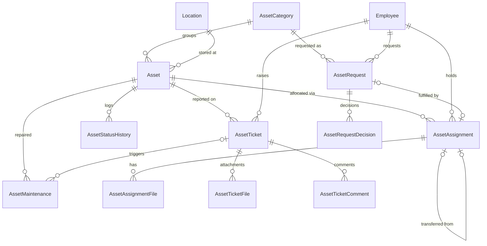
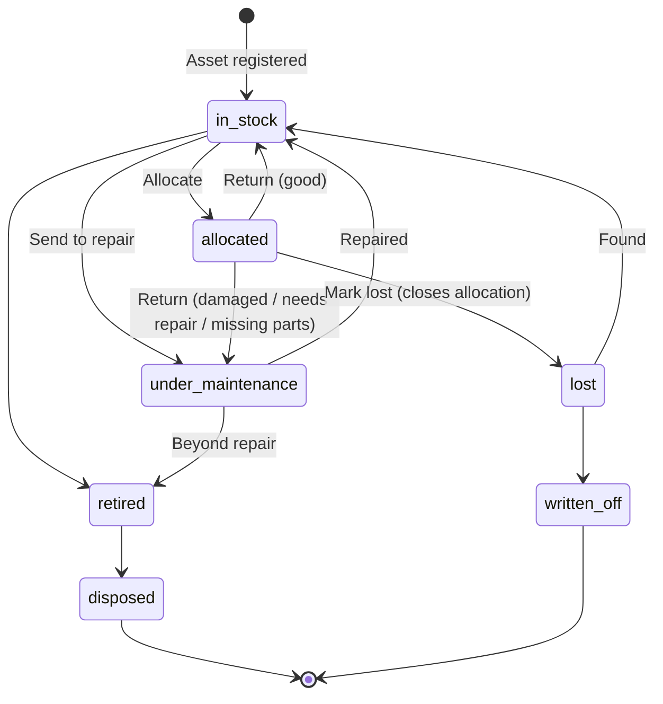
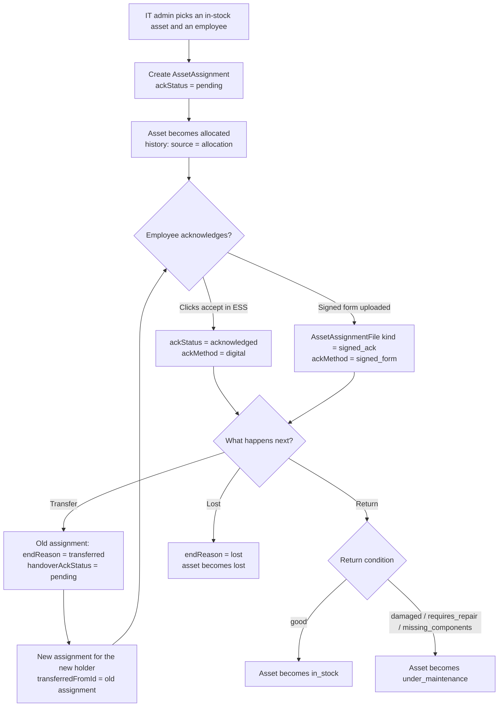
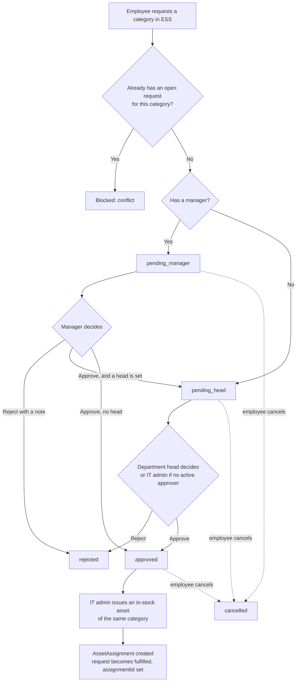
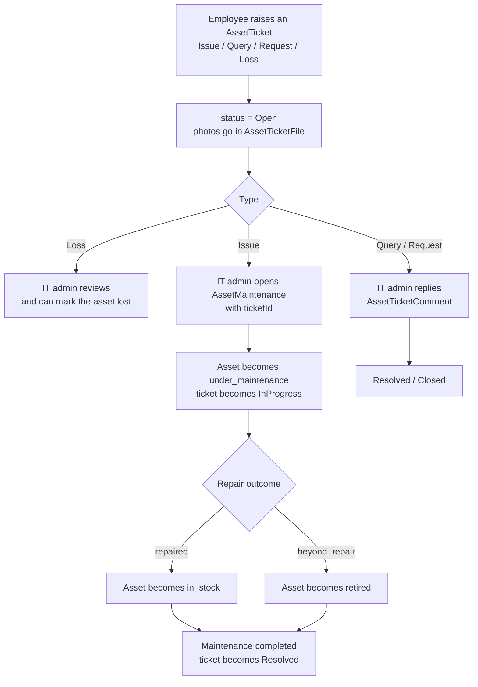

# PeopleOS — Asset Module: Data Model and Flows

**Module:** IT Assets (register, allocation, requests, tickets, maintenance)  
**As of:** 4 Nov 2026 (code on `main`, including uncommitted asset work and the `20261103120000_asset_screens` and `20261104120000_asset_sheet_columns` migrations)  
**Source of truth:** [schema.prisma](../apps/api/prisma/schema.prisma) (asset models), [asset-rules.ts](../apps/api/src/assets/asset-rules.ts), and the services in [apps/api/src/assets](../apps/api/src/assets)

**Visual version:** open [35-asset-module-diagram.html](35-asset-module-diagram.html) in a browser for the drawn table map and status lifecycle (no Mermaid needed).

All asset tables are tenant-scoped (`tenantId` → `Tenant`, cascade on delete). Most tables also have `createdAt`, `updatedAt`, `createdById` and `updatedById`; they are left out of the tables below.

### Permissions

| Permission | Who has it (default matrix) | Allows |
| --- | --- | --- |
| `assets.self` | Every employee | View own assets, acknowledge, report faults or loss, request assets |
| `assets.manage` | `IT_ADMIN`, `HR_HEAD` | Register, categories, allocation, returns, status changes, maintenance, reports |
| `assets.tickets.manage` | `IT_ADMIN`, `HR_HEAD` | Handle asset tickets and requests |

---

## 1. Tables

### AssetCategory — asset types (Laptop, Mobile, ...)

| Column | Type | Notes |
| --- | --- | --- |
| id | String PK | cuid |
| tenantId | FK → Tenant | |
| code | String | Unique per tenant, e.g. `laptop` |
| name | String | |
| tagPrefix | String | Unique per tenant, e.g. `LAP` |
| nextTagNumber | Int | Counter for auto tags, formatted `LAP-0007` |
| fields | Json | Custom field definitions: `[{ key, label, type: text\|number\|date, required }]` |
| usefulLifeMonths | Int | Straight-line depreciation period for book value (default 48) |
| active | Boolean | |

Default categories: Laptop (RAM, Storage, Processor, OS), Mobile (IMEI, Device Number), ID Card, Furniture, Access Card, Software Licence (Licence Key, Seat Count), Monitor, Other.

### Asset — the register

| Column | Type | Notes |
| --- | --- | --- |
| id | String PK | |
| tenantId | FK → Tenant | |
| assetTag | String | Unique per tenant |
| categoryId | FK → AssetCategory | Restrict on delete |
| name, make, model | String | |
| serialNo | String? | Unique per tenant; stored upper-case, blank means none |
| status | AssetStatus | `in_stock` · `allocated` · `under_maintenance` · `lost` · `retired` · `disposed` · `written_off` |
| purchasedOn | DateTime? | |
| vendor | String | |
| owner | String | Who owns the device (company, client, rental vendor); sheet column "Assest Owner" |
| cost | Decimal(12,2)? | |
| warrantyExpiry | Date? | |
| locationId | FK → Location? | Set null on delete |
| photoPath, description | String | `description` is the sheet's "Remarks" |
| condition | String | Condition as written in an imported sheet; issue and return conditions take over once recorded |
| customFields | Json | Values for the category's `fields` |

Indexes: `(tenantId, status)`, `(tenantId, categoryId)`, `(tenantId, locationId)`.

### AssetAssignment — one row per allocation

An allocation is open while `returnedOn` is null.

| Column | Type | Notes |
| --- | --- | --- |
| id | String PK | |
| assetId | FK → Asset | |
| employeeId | FK → Employee | |
| assignedOn | DateTime | |
| expectedReturnOn | Date? | |
| issueCondition, accessories, conditionNotes | String | |
| project, contactMobile, employmentType | String | Project or work the device is for, and the holder's mobile and employment type at issue |
| issuedById | FK → User? | |
| ackStatus | AssetAckStatus | `pending` · `acknowledged` · `not_recorded` |
| ackDueOn | Date? | Accept-by date, set from "accept within N working days" at issue |
| ackAt, ackById, ackMethod | | `ackMethod`: `digital` or `signed_form` |
| returnedOn, returnedById | | |
| returnCondition | AssetReturnCondition? | `good` · `damaged` · `requires_repair` · `missing_components` |
| damageNotes, inspectionNotes | String | |
| endReason | AssetAssignmentEnd? | `returned` · `transferred` · `lost` |
| transferredFromId | FK → AssetAssignment? | Unique; links a chain of transfers |
| transferReason | String | |
| handoverAckStatus, handoverAckAt, handoverAckById, handoverAckMethod | | Previous holder confirms the handover |

Indexes: `(tenantId, employeeId, returnedOn)`, `(assetId, returnedOn)`.

### AssetAssignmentFile — allocation attachments

| Column | Type | Notes |
| --- | --- | --- |
| id | String PK | |
| assignmentId | FK → AssetAssignment | |
| kind | String | `signed_ack` · `handover_ack` · `return_photo` |
| fileName, storagePath | String | |
| uploadedById, uploadedAt | | |

### AssetStatusHistory — every status change (never edited)

| Column | Type | Notes |
| --- | --- | --- |
| id | String PK | |
| assetId | FK → Asset | |
| fromStatus, toStatus | AssetStatus | |
| reason | String | |
| source | String | `allocation` · `return` · `status` · `maintenance` |
| changedById, changedAt | | |

### AssetMaintenance — repair records

A partial unique index allows only one open record per asset.

| Column | Type | Notes |
| --- | --- | --- |
| id | String PK | |
| assetId | FK → Asset | |
| ticketId | FK → AssetTicket? | The employee report that triggered the repair |
| issue, vendor, vendorContact | String | |
| startedOn, expectedOn, completedOn | Date | |
| cost | Decimal(12,2)? | |
| status | AssetMaintenanceStatus | `open` · `completed` |
| stage | String | Repair board column while open: `with_vendor` · `testing` · `ready` |
| outcome | AssetRepairOutcome? | `repaired` · `beyond_repair` |
| outcomeNotes | String | |

### AssetTicket — employee reports (reference `AT-000123`)

| Column | Type | Notes |
| --- | --- | --- |
| id | String PK | |
| number | Int | Unique, autoincrement |
| employeeId | FK → Employee | |
| assetId | FK → Asset? | |
| type | AssetTicketType | `Issue` · `Query` · `Request` · `Loss` |
| category | String | Fault category (hardware, software, physical_damage, battery, accessories_missing, other); `lost`/`stolen` for Loss; `return` for an employee's return request (type Request) |
| priority | AssetTicketPriority | `low` · `medium` · `high` |
| lostOn, lostLocation | | Used by `Loss` tickets |
| subject, body | String | |
| status | AssetTicketStatus | `Open` · `InProgress` · `Resolved` · `Closed` |

### AssetTicketFile and AssetTicketComment

| Table | Columns |
| --- | --- |
| AssetTicketFile | `id`, `ticketId` (FK), `fileName`, `storagePath`, `uploadedById`, `uploadedAt` |
| AssetTicketComment | `id`, `ticketId` (FK, cascade), `authorId`, `body`, `createdAt` |

### AssetRequest — new-asset requests (reference `AR-000123`)

| Column | Type | Notes |
| --- | --- | --- |
| id | String PK | |
| number | Int | Unique, autoincrement |
| employeeId | FK → Employee | Requester |
| categoryId | FK → AssetCategory | |
| reason | String | |
| status | AssetRequestStatus | `pending_manager` · `pending_head` · `approved` · `rejected` · `fulfilled` · `cancelled` |
| managerApproverId | FK → Employee? | Set when the request is created |
| headApproverId | FK → Employee? | Set when the request is created |
| fulfilledById, fulfilledAt | | |
| assignmentId | FK → AssetAssignment? | Unique; the allocation that fulfilled it |

### AssetRequestDecision — one row per approval step (never edited)

| Column | Type | Notes |
| --- | --- | --- |
| id | String PK | |
| requestId | FK → AssetRequest | |
| step | String | `manager` · `head` · `admin` |
| approved | Boolean | |
| note | String | Required when declining |
| decidedById, decidedAt | | |

---

## 2. Relationships

---

## 3. Flows

### 3.1 Asset status lifecycle

These are the only moves allowed (`NEXT_STATUSES`). `disposed` and `written_off` are final. An allocated asset leaves allocation only through Return or Mark lost, so the return condition is always recorded.

### 3.2 Allocate, acknowledge, transfer, return

### 3.3 New-asset request and approvals

Rules:

- The head step is skipped when the department head is the requester or is also their manager.
- If the approver for the current step is missing or inactive, an IT admin decides that step (`step = admin`).
- Every decision adds a row to `AssetRequestDecision`.

### 3.4 Ticket and repair

Rules:

- An asset can have only one open (`Open` or `InProgress`) `Loss` ticket at a time.
- Returning an asset in any condition other than `good` sends it to `under_maintenance`.
