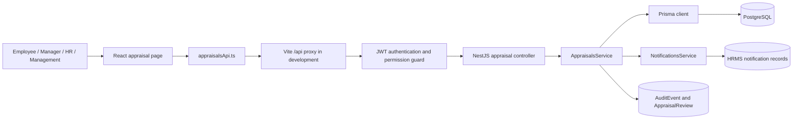
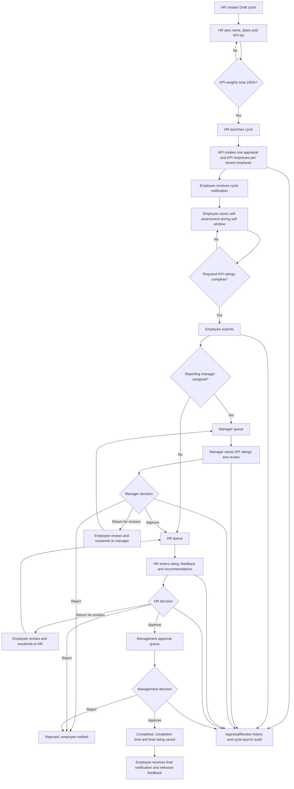
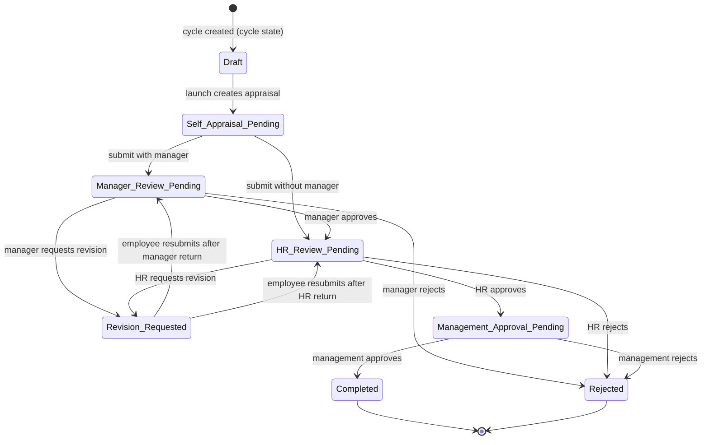
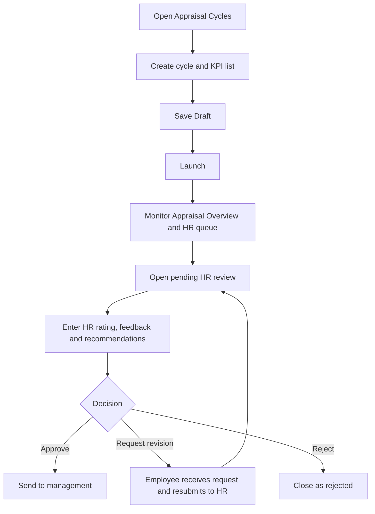
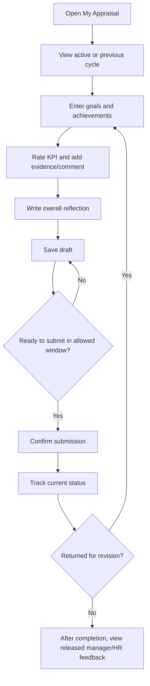
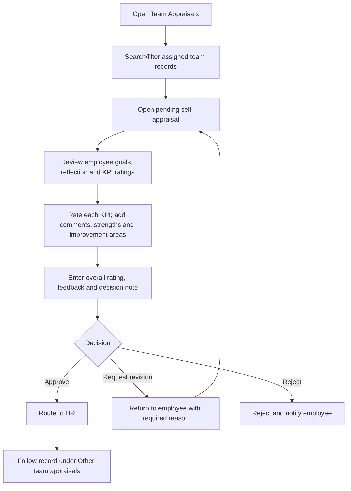
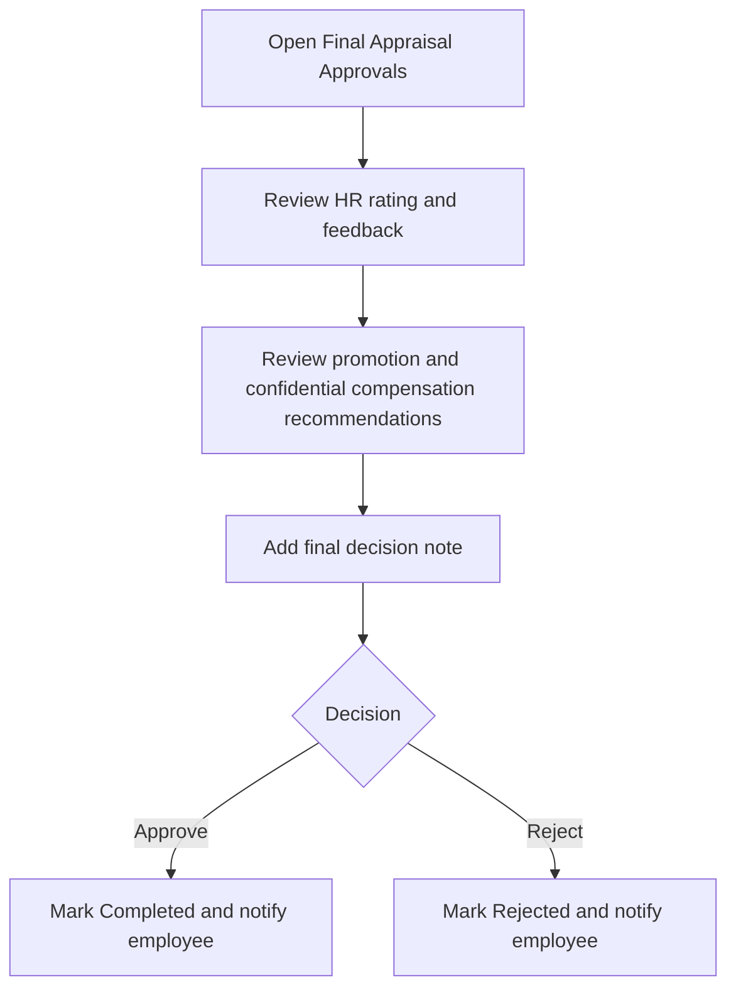
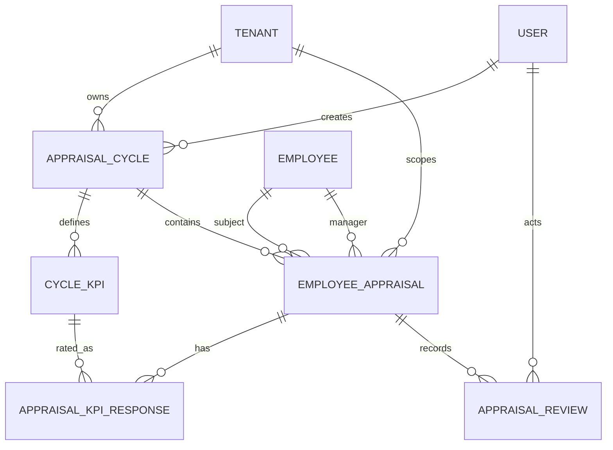

# Appraisal Management Module

**Project:** PeopleOS HRMS  
**Documentation type:** Implementation guide and source-code reference  
**Reviewed:** 23 November 2026  
**Status:** Documents the implementation present in this repository. Proposed or missing FRS capabilities are labeled as such.

## 1. Executive summary

The implemented appraisal module supports a tenant-scoped cycle with weighted KPI definitions, employee self-assessment, reporting-manager review, HR review, management approval, notifications, status history, audit events, reports, and an administrative overview. Appraisal records are created for the employees in the tenant when HR launches a cycle.

The implemented path is:

`Draft cycle → Active cycle / Self_Appraisal_Pending → Manager_Review_Pending (when assigned) → HR_Review_Pending → Management_Approval_Pending → Completed`

Reviewers can return an employee appraisal for revision or reject it. A missing manager routes a submitted self-appraisal directly to HR. Approval and rejection decisions are recorded in appraisal history and, for workflow decisions, the general audit event table. Notifications are sent at cycle launch and selected submission and decision points.

The attached FRS describes a much broader process. Important requirements such as KRA drafting and employee acceptance, cross-functional reviewers, skip-level approvals, calibration, publication/acknowledgement, appeals, population rules, configurable templates/scales, and payroll/talent integrations are not implemented in the code reviewed. The current product should therefore be described as a core sequential appraisal workflow, not as a completed implementation of the entire FRS.

## 2. Scope and terminology

### What this module does

- Lets HR create and launch appraisal cycles and define required or optional KPIs whose weights total 100%.
- Creates one appraisal per employee in the tenant at cycle launch.
- Lets employees save and submit a self-assessment during the configured self-assessment window.
- Routes submissions to the employee’s stored reporting manager, or directly to HR when no manager is stored.
- Lets the assigned manager save ratings and feedback, then approve, request revision, or reject.
- Lets HR record a rating and feedback, add promotion/compensation recommendations, then approve to management, request revision, or reject.
- Lets a management approver approve the recommendation (completing the appraisal) or reject it.
- Shows role-based queues, summaries, cycle progress and appraisal history; sends in-app appraisal notifications through the existing notification service.

### Important terms

| Term | Meaning in the current code |
|---|---|
| Cycle | A named tenant-level appraisal period with period dates, self-appraisal dates, a review deadline, and Draft/Active/Closed state. |
| KPI | A cycle-level performance criterion with title, category, description, weight, required flag and sort order. The UI labels these “Performance criteria.” |
| Appraisal | One employee’s record for one cycle. A database uniqueness rule permits one record per employee and cycle. |
| Revision return stage | A string on the appraisal identifying whether a revision request came from the manager or HR. It determines where the employee’s resubmission returns. |
| Review history | Append-only-by-application entries in `AppraisalReview` describing saved reviews, stage decisions, comments and status movements. |
| Audit event | A separate HRMS audit record used for cycle and workflow decisions. It complements appraisal history. |

The current “KPI” model does not provide the full FRS KRA model: it has no target, measure, due date, goal alignment or employee acceptance fields.

## 3. Implementation map

| Area | Source files | Responsibility |
|---|---|---|
| API module | `apps/api/src/appraisals/appraisals.module.ts` | Registers appraisal controllers and service; imports notification and RBAC modules. |
| API routes | `apps/api/src/appraisals/appraisals.controller.ts` | Self, manager, HR, cycle, admin, management and report endpoints; authentication and permission decorators. |
| Business rules | `apps/api/src/appraisals/appraisals.service.ts` | Cycle lifecycle, ownership and manager checks, validations, transitions, notifications, audit and view masking. |
| Request validation | `apps/api/src/appraisals/dto/appraisal.dto.ts` | DTO field types, ranges, sizes, dates, nested-array validation. |
| Database model | `apps/api/prisma/schema.prisma` | Appraisal enums and Prisma relations for cycles, KPIs, appraisals, responses and reviews. |
| Database migration | `apps/api/prisma/migrations/20261119120000_appraisal_management/migration.sql` | Adds appraisal enums, permissions, management-approver role, tables, indexes and foreign keys. |
| Frontend API client | `apps/web/src/workspace/appraisalsApi.ts` | Typed frontend wrappers around `/api/v1` appraisal endpoints. |
| Role workspaces | `apps/web/src/workspace/AppraisalPages.tsx` | Employee, manager, HR, management and cycle screens plus reusable review cards. |
| Admin overview/details | `apps/web/src/workspace/AppraisalAdminPage.tsx` | Organization dashboard, searchable/filterable/sortable/paginated listing, CSV export, record detail page and history tabs. |
| Styling | `apps/web/src/workspace/appraisals.css` | Shared appraisal UI styles, responsive layouts and state presentation. |
| Route wiring | `apps/web/src/App.tsx` | Protected page routes and role-based parent routes. |
| Navigation | `apps/web/src/layout/appNav.ts` | Sidebar links and role visibility for appraisal pages. |
| Permission catalog | `apps/api/src/rbac/role-matrix.ts` | Permission definitions and role-to-permission matrix. |
| Notification integration | `apps/api/src/notifications/` | Existing HRMS notification service used by appraisal workflow events. |

## 4. Architecture and request flow

For a browser action, the page calls a function from `appraisalsApi.ts`. The shared `apiFetch` attaches the bearer token, sends JSON, handles token refresh on 401, and turns unsuccessful responses into errors. NestJS applies the global `/api/v1` prefix and a global validation pipe. Controller guards authenticate the user and check permissions. The service applies tenant, employee-owner, assigned-manager, workflow-state and sensitive-field checks, then uses Prisma to read or write records. Notifications and audit entries use existing HRMS services/tables.

In the Vite development setup, `apps/web/vite.config.ts` proxies `/api` to `http://localhost:3000`. The UI expects the API to be available there.

## 5. End-to-end workflow

### What is different from the requested FRS sequence

| FRS step | Current implementation |
|---|---|
| HR creates a cycle | Implemented. Cycle creation includes name and period/self/review dates. |
| HR configures settings, timelines and eligibility | Partially implemented. Dates and KPI definitions/weights are configurable. There are no eligibility rules, population preview, unit-specific windows, template assignment, or HR Head cycle-design approval. Launch includes every `Employee` row for the tenant. |
| Employee receives notification | Implemented at launch through the in-app notification service. No email notification is created in this module. |
| Employee completes self-appraisal | Implemented as goals, achievements, overall reflection and KPI self-rating/comment fields. No separate competency, development-plan or career-aspiration sections. |
| Employee submits | Implemented. Required KPI ratings and the self window are checked server-side. Goals, achievements and overall reflection are not required by the server. |
| Manager reviews | Implemented for appraisal records whose stored `managerEmployeeId` matches the current manager. |
| Manager rates and provides feedback | Implemented with KPI ratings/comments, an overall rating, feedback, strengths and improvement areas. Manager recommendation categories from the FRS are not modeled. |
| HR verifies | Implemented with an HR rating, feedback and recommendation fields. HR may approve, request revision or reject. |
| Management approval | Implemented as approve-to-complete or reject. No skip-level or department-head stage precedes it. |
| Final status/outcome communicated | Completion and rejection notifications are sent. Employee-facing manager/HR feedback is released only when status is `Completed`. HR approval also sends an interim employee notification before management’s final decision. |
| History and records | Implemented in `AppraisalReview`; decision actions also create `AuditEvent` rows. The system has no separate immutable audit database or per-field audit rows. |

### Status lifecycle

The database enum contains `Draft`, `Self_Appraisal_Pending`, `Submitted`, `Manager_Review_Pending`, `Manager_Approved`, `HR_Review_Pending`, `HR_Approved`, `Management_Approval_Pending`, `Completed`, `Rejected`, and `Revision_Requested`.

The code’s persisted `EmployeeAppraisal.status` path is narrower than that enum suggests. On employee submission, the stored status is set directly to `Manager_Review_Pending` or `HR_Review_Pending`; `Submitted` is recorded as an intermediate `AppraisalReview.toStatus`. Manager approval stores `HR_Review_Pending`; `Manager_Approved` is recorded in history. HR approval stores `Management_Approval_Pending`; `HR_Approved` is recorded in history. Thus `Submitted`, `Manager_Approved`, and `HR_Approved` are defined and may appear in history/UI compatibility logic, but they are not the normal persisted status immediately after those decisions.

Cycle status is a separate lifecycle: `Draft → Active → Closed`. A cycle can close only when every appraisal in it is `Completed` or `Rejected`.

## 6. Role-wise journeys

### HR / HR Executive / HR Head

Access comes from `appraisal.cycle.manage`, `appraisal.hr.read`, `appraisal.hr.review`, `appraisal.compensation.read`, and (for the overview route) `appraisal.admin.read`, assigned to HR roles by the role matrix. HR lists are tenant scoped. The cycle page supports create, launch and close; the HR queue supports search/status filtering and decisions. There is no HR Head cycle-approval gate or configurable eligibility/template/pause/extension UI.

### Employee

The employee can read only their own appraisal. Self-ratings/comments and reflection are visible before completion; manager and HR ratings/feedback are masked until `Completed`. On a revision request, the latest request comment is shown. The UI allows draft saves and confirmation before submission.

### Reporting manager

The queue is restricted to records with `managerEmployeeId` equal to the manager’s linked employee record. Manager actions also enforce this relationship and prevent a manager from reviewing their own appraisal. The UI includes KPI ratings/comments, overall rating, feedback, strengths, improvement areas, decision note, and confirmation dialogs. It does not include team-wide rating distribution or previous-cycle comparisons.

### Management approver

Management sees only `Management_Approval_Pending` queue records. Compensation fields are returned only to a caller with `appraisal.compensation.read`. The management controller itself requires `appraisal.management.review`. The final rating is set from the HR rating when management approves. There is no independent “publish” or employee acknowledgement action.

## 7. Screens and user interface

All pages use the shared `appraisals.css` styles, status badges, loading/error/empty messaging and the authenticated application shell.

| Screen | Access | Purpose and visible controls | API calls and data | Result / limits |
|---|---|---|---|---|
| **My Appraisal** (`/ess/appraisals`) | User with `appraisal.self` | Current and prior appraisals; edit goals and achievements (one per line), KPI rating/evidence, reflection; Save draft and Submit with confirmation; status and revision note. | `GET /appraisals/me`; `PUT /appraisals/me/:id`; `POST /appraisals/me/:id/submit`; `GET /appraisal-reports/me`. Uses `EmployeeAppraisal`, `CycleKpi`, `AppraisalKpiResponse`, `AppraisalReview`. | Submissions require every required KPI rating and must be within the active self window, except a revision resubmission. No backend requirement for non-KPI text fields. |
| **Team Appraisals** (`/manager/appraisals`) | `MANAGER`; API requires `appraisal.team.read`, decisions additionally `appraisal.manager.review` | Search by employee name/code; status filter; pending review and collapsible other records; review KPI ratings/comments, overall feedback/rating/strengths/improvement areas; approve, request revision or reject with confirmation. | `GET /appraisals/manager`; `PUT /appraisals/manager/:id/review`; `POST /appraisals/manager/:id/{approve,request-revision,reject}`; `GET /appraisal-reports/manager`. Uses appraisal, KPI responses, employee/manager relation, history. | Server verifies assigned manager and required KPI ratings on review save. UI disables actions until ratings are complete. Manager approval API does not independently require that a review save occurred first. |
| **Appraisal Review** (`/hr/appraisals`) | `HR_EXEC` / `HR_HEAD`; `appraisal.hr.read`, writes need `appraisal.hr.review` | Search employee/code; status filter; pending and other appraisals; manager feedback and KPI assessments; HR rating/feedback; promotion and salary recommendation fields; approve, request clarification or reject with confirmation. | `GET /appraisals/hr`; `GET /appraisals/hr/:id`; `POST /appraisals/hr/:id/{approve,request-revision,reject}`; `GET /appraisal-reports/hr`. Uses the same appraisal tables plus confidential fields for authorized reviewers. | HR approve routes to management. HR return goes to the employee and resumes at HR. The API saves HR fields during approval; there is no separate HR draft-save route. |
| **Appraisal Cycles** (`/hr/appraisal-cycles`) | `appraisal.cycle.manage` | Create cycle; period and self/review dates; KPI lines formatted `title | category | weight`; see cycle status, headcount and KPI count; Launch or Close. | `GET/POST /appraisal-cycles`; `PUT /appraisal-cycles/:id/kpis`; `POST /appraisal-cycles/:id/launch`; `POST /appraisal-cycles/:id/close`. Uses `AppraisalCycle`, `CycleKpi`, `EmployeeAppraisal`, KPI responses and history. | Cycle creation and KPI save are two requests. A cycle needs at least one KPI and total KPI weight 100% to launch. No population selector, preview, edit-window, clone, schedule, pause or cancellation controls. |
| **Appraisal Overview** (`/admin/appraisals`) | `SECURITY_ADMIN`, `HR_EXEC`, `HR_HEAD` plus `appraisal.admin.read` | Summary cards; cycle completion, deadlines, status/department views, recent activity; searchable/filterable/sortable listing with employee ID/name, department, designation, manager, cycle, self/manager rating, status, last update; pagination and CSV export. Clicking a row opens detail. | `GET /appraisals/admin`; report-independent client-side aggregation; details use `GET /appraisals/admin/:id`. Reads tenant appraisals, employee/department/manager, cycle, KPI response and history. | Ratings shown in listing are arithmetic averages of non-null KPI ratings, not weighted KPI scores. Overview masks `finalRating` and compensation fields. Filtering/paging is client side after loading all tenant records. |
| **Appraisal Record Details** (`/admin/appraisals/:id`) | Same as overview | Separate record page with overview, self-appraisal, manager review, HR review, final approval and history tabs; workflow stepper and employee/cycle facts. | `GET /appraisals/admin/:id`; reads appraisal, employee/org relations, cycle, KPI responses and review history. | This is read-only. Sensitive compensation details are not returned by this admin endpoint. |
| **Final Appraisal Approvals** (`/management/appraisals`) | `MANAGEMENT_APPROVER`, `appraisal.management.review`; compensation display additionally depends on `appraisal.compensation.read` | Pending queue, HR rating/feedback, promotion and compensation recommendation, final note, approve and reject with confirmation. | `GET /appraisals/management`; `POST /appraisals/management/:id/approve`; `POST /appraisals/management/:id/reject`; `GET /appraisal-reports/management`. | Approval sets `Completed`, `completedAt`, management note and final rating from HR rating. Rejection sets `Rejected`. |

### Admin overview behavior

The admin listing includes CSV export and supports client-side search by employee name/code; filters for status, department and cycle; sort columns for employee ID/name, department, designation, manager, cycle, ratings, status and last update; and page sizes of 10, 25 or 50. Summary cards can set a status filter. The detail page is separate from the table and contains a tabbed read-only view.

### Cycle fields and validations

Cycle create fields: name (max 120 characters), period start, period end, self start, self deadline and review deadline (ISO date strings). Service validation checks chronological relations `periodEnd >= periodStart`, `selfDeadline >= selfStart`, and `reviewDeadline >= selfDeadline`. It does not validate every date against the period or prevent overlapping cycles. Cycle names are unique per tenant.

KPI fields: title (max 120), optional description (max 1,000), optional category (max 80), weight (number greater than 0 and at most 100), optional required flag and optional nonnegative sort order. KPI total weight must be 100 within a 0.01 tolerance. KPIs can only be changed while the cycle is Draft.

## 8. API reference

All routes below are under `/api/v1`. All appraisal routes require a valid JWT. Permission checks use the `PermissionsGuard`; controller-level permissions apply unless an endpoint overrides them. The application’s DTO validation pipe rejects unknown properties and transforms nested DTOs.

### Employee self-service

| Method and path | Permission | Purpose |
|---|---|---|
| `GET /appraisals/me` | `appraisal.self` | Return the caller’s current and previous appraisals. |
| `GET /appraisals/me/:id` | `appraisal.self` | Return one appraisal only when it belongs to the caller’s employee profile. |
| `PUT /appraisals/me/:id` | `appraisal.self` | Save editable self fields and KPI ratings/comments. |
| `POST /appraisals/me/:id/submit` | `appraisal.self` | Validate and submit; route to manager or HR. |

### Manager

| Method and path | Permission | Purpose |
|---|---|---|
| `GET /appraisals/manager` | `appraisal.team.read` | Return appraisal records assigned to the caller’s employee record as manager. |
| `PUT /appraisals/manager/:id/review` | `appraisal.manager.review` | Save manager KPI ratings/comments, overall rating, feedback, strengths and improvement areas while pending. |
| `POST /appraisals/manager/:id/approve` | `appraisal.manager.review` | Route pending record to HR. |
| `POST /appraisals/manager/:id/request-revision` | `appraisal.manager.review` | Return pending record to employee with required comment. |
| `POST /appraisals/manager/:id/reject` | `appraisal.manager.review` | Reject pending record. |

### HR

| Method and path | Permission | Purpose |
|---|---|---|
| `GET /appraisals/hr` | `appraisal.hr.read` | Return tenant HR queue; sensitive compensation fields are masked unless caller also has `appraisal.compensation.read`. |
| `GET /appraisals/hr/:id` | `appraisal.hr.read` | Return one tenant appraisal with permission-dependent sensitive fields/history. |
| `POST /appraisals/hr/:id/approve` | `appraisal.hr.review` | Save HR rating, feedback, recommendations and route to management. |
| `POST /appraisals/hr/:id/request-revision` | `appraisal.hr.review` | Return to employee; on resubmission HR review resumes. |
| `POST /appraisals/hr/:id/reject` | `appraisal.hr.review` | Reject a record pending HR review. |

### Cycles, management, admin and reports

| Method and path | Permission | Purpose |
|---|---|---|
| `GET /appraisal-cycles` | `appraisal.cycle.manage` | List tenant cycles, KPI definitions and appraisal counts. |
| `POST /appraisal-cycles` | `appraisal.cycle.manage` | Create a Draft cycle. |
| `PUT /appraisal-cycles/:id/kpis` | `appraisal.cycle.manage` | Replace KPI list on a Draft cycle. |
| `POST /appraisal-cycles/:id/launch` | `appraisal.cycle.manage` | Activate cycle and create employee records/responses/history/notifications. |
| `POST /appraisal-cycles/:id/close` | `appraisal.cycle.manage` | Close Active cycle when all appraisals are Completed or Rejected. |
| `GET /appraisals/management` | `appraisal.management.review` | Return pending management approvals; sensitive fields are permission masked. |
| `POST /appraisals/management/:id/approve` | `appraisal.management.review` | Complete the appraisal and notify employee. |
| `POST /appraisals/management/:id/reject` | `appraisal.management.review` | Reject final recommendation and notify employee. |
| `GET /appraisals/admin` | `appraisal.admin.read` | Return tenant overview records with compensation/final rating fields masked. |
| `GET /appraisals/admin/:id` | `appraisal.admin.read` | Return tenant-scoped details and history; no compensation fields. |
| `GET /appraisal-reports/me` | `appraisal.self` | Own status counts and total. |
| `GET /appraisal-reports/manager` | `appraisal.team.read` | Team status counts and total. |
| `GET /appraisal-reports/hr` | `appraisal.hr.read` | Tenant status counts, department counts and average final rating. |
| `GET /appraisal-reports/management` | Both `appraisal.management.review` and `appraisal.compensation.read` | Status/department summary plus promotion and compensation summaries. |

### Request validation

Self-save DTO accepts optional arrays `goals` and `achievements`, `selfFeedback` up to 5,000 characters, and KPI entries with a KPI ID, optional integer rating from 1–5, and optional comment up to 3,000 characters. The service rejects KPI IDs not belonging to that appraisal’s cycle.

Manager review requires KPI entries (rating integer 1–5), feedback (up to 5,000), strengths and improvement areas (up to 3,000 each), overall numeric rating 1–5, and optional comment up to 3,000. The service verifies every required KPI appears in the submitted list and no supplied KPI is outside the appraisal.

HR review requires feedback up to 5,000 and rating 1–5. Promotion recommendation is optional (up to 2,000); salary increase percent is optional from 0–100; salary increase amount is optional and nonnegative; comment is optional up to 3,000. Decision comments are optional up to 5,000. Revision comments are required up to 5,000.

## 9. Database model and relationships

| Table / Prisma model | Main fields | Relationships and purpose |
|---|---|---|
| `AppraisalCycle` | `id`, `tenantId`, `name`, period/self/review dates, cycle `status`, `createdById`, timestamps | Belongs to Tenant and creator User. Has KPIs and appraisals. Unique `(tenantId,name)`; indexed by tenant/status. |
| `CycleKpi` | `id`, `cycleId`, title, description, category, decimal weight, required, sortOrder | Belongs to cycle; has responses. Deleted with cycle; indexed by cycle/order. |
| `EmployeeAppraisal` | `id`, tenant/cycle/employee/manager IDs, status, revision return stage, JSON goals/achievements, employee/manager/HR/management feedback and ratings/recommendations, submission/completion and timestamps | Belongs to Tenant, Cycle, subject Employee and optional manager Employee. Unique `(cycleId,employeeId)`; indexed for tenant/status, cycle/status, manager/status and employee/createdAt. |
| `AppraisalKpiResponse` | `id`, appraisal/KPI IDs, self rating/comment, manager rating/comment | One row per appraisal/KPI; unique `(appraisalId,cycleKpiId)`. Appraisal deletion cascades; KPI deletion is restricted when responses exist. |
| `AppraisalReview` | `id`, appraisal/actor IDs, stage, action, from/to statuses, comment, JSON changes, createdAt | Workflow history linked to appraisal and actor User. Indexed by appraisal/time and actor/time. Appraisal deletion is restricted. |

Foreign keys retain employee, cycle, creator and actor records where required; the optional manager reference is set null if that employee is deleted. Cycle deletion cascades KPIs, while appraisals prevent deleting a cycle in use. The migration is additive for these tables and indexes; it does not migrate historical legacy appraisal data into the new model. The migration seeds the core appraisal permissions and management-approver links, but it does not insert `appraisal.admin.read`; that permission is present in the code role matrix. `PermissionsService` merges matrix permissions with stored role links, which is why the running Security Admin can receive it even when the permission row is absent from this migration’s insert list.

The module reuses the existing `Tenant`, `User`, `Employee`, `Department`, `Role`, `Permission`, `RolePermission`, `Notification` and `AuditEvent` models. It adds no duplicate employee/user/department/role tables.

## 10. Permissions and data visibility

| Permission | Intended use / role assignment in current matrix |
|---|---|
| `appraisal.self` | Own appraisal read/write/submit; employee, manager and HR roles. |
| `appraisal.team.read` | Manager team queue and report; Manager. |
| `appraisal.manager.review` | Manager review and decisions; Manager. |
| `appraisal.hr.read` | Tenant HR queue/detail and report; HR_EXEC, HR_HEAD. |
| `appraisal.hr.review` | HR decisions; HR_EXEC, HR_HEAD. |
| `appraisal.cycle.manage` | Cycle management; HR_EXEC, HR_HEAD. |
| `appraisal.management.review` | Management queue and decisions; MANAGEMENT_APPROVER. |
| `appraisal.compensation.read` | Confidential compensation and promotion recommendations; HR and management approver roles. |
| `appraisal.admin.read` | Admin overview/detail; Security Admin, HR_EXEC, HR_HEAD. |

The RBAC permission service combines stored role-permission links with the application role matrix to tolerate a database catalog that lags the code matrix. The API applies permissions independently of frontend route guards.

Data visibility enforced in API view builders:

- Employee endpoints constrain appraisal lookup to `employee.userId` and the authenticated tenant. Manager/HR ratings are only included in the employee view after status `Completed`; KPI manager values are also omitted before completion.
- Manager queue constrains rows to the manager employee ID stored on the appraisal and verifies that relation for writes.
- HR queue/detail are tenant scoped. Salary/promotion fields are included only with compensation permission.
- Management decisions require management permission; management queue includes sensitive fields only with compensation permission.
- Admin overview/detail remove final rating and do not return compensation recommendations.
- Manager, HR and management write paths block a reviewer from acting on their own appraisal.

The module uses HTTP 403 for some relationship failures (for example manager action on an appraisal outside their assignment). This is the current behavior; the FRS proposes 404 for relationship failures. The FRS also asks that a system administrator have no review-content access; the current `appraisal.admin.read` view returns employee/manager/HR feedback but masks compensation and final rating. Organizations should assess this difference against their access policy.

## 11. Notifications, history, audit and errors

### Notifications currently sent

| Trigger | Recipient | Notification |
|---|---|---|
| Cycle launch | Every employee included in the cycle with a linked user | Self-appraisal pending, cycle name, deadline and ESS link. |
| Employee submits with manager | Linked manager user | Manager review pending. |
| Employee submits without manager | Users in HR_EXEC/HR_HEAD roles | HR review pending. |
| Manager approves | Employee and HR_EXEC/HR_HEAD users | Manager approval and HR review pending. |
| Manager requests revision | Employee | Revision reason and ESS link. |
| HR approves | Employee and MANAGEMENT_APPROVER users | HR progress notice and management approval pending. |
| HR requests revision | Employee | Clarification reason and ESS link. |
| HR rejects | Employee | Rejection and comment/default reason. |
| Management approves/rejects | Employee | Final completion or rejection and link. |

Notifications use `NotificationsService.notify` with `kind: appraisal`. This module does not implement an outbox, scheduled reminder job, due-date escalations, notification preference controls or email delivery itself.

### History and audit behavior

`AppraisalReview` entries are written for cycle initiation, self draft saves, submission/routing, manager review save/approval, HR approval, revision request and decisions through the shared transition helper. They include the actor, stage, action, status transition, comment and, for some saves, a `changes` JSON object. Admin details return actor email and comments; employee history limits comments to revision requests. HR history is redacted unless sensitive-review permission is available. General `AuditEvent` entries are written for cycle launch/close and important decision/transition actions. The general audit log is not a per-field history of all edits.

### Error handling

The service reports common invalid operations with NestJS exceptions: `BadRequest` for invalid weights/KPI references/missing required ratings, `Conflict` for invalid status/window/cycle operations or concurrent updates, `Forbidden` for missing employee profile/unauthorized relationship/self-approval, and `NotFound` for missing tenant-scoped records. The shared frontend API client turns failed HTTP responses into an `Error` message; screens display page-level error states and preserve loading/empty states.

## 12. Reporting and calculations

- Employee report: status counts and total for the linked employee; returns empty counts if there is no employee profile.
- Manager report: status counts for records where the caller’s employee profile is the stored manager.
- HR report: tenant counts and department totals plus average `finalRating` where present.
- Management report: same department/status data plus count of promotion recommendations and salary recommendation count, total proposed amount and average percent. The report endpoint requires both management review and compensation read permissions.
- Admin dashboard computes its cards, progress, department completion, deadlines and recent activity from the list API response. Search, filters, sorting and pagination are client-side.
- Admin table rating columns calculate the simple arithmetic mean of non-null self/manager KPI ratings. The KPI weights are not applied to these table means. There is no weighted score calculation service in the reviewed code.

## 13. FRS gap and implementation status

This section prevents the current implementation from being mistaken for the larger attached specification.

| FRS capability | Status in this repository |
|---|---|
| Annual/half-yearly/quarterly cycle type and linked financial year | Missing; cycle has only a name and dates. |
| Stage-specific windows for all stages and unit/location overrides | Partial; only period, self window and one review deadline exist. |
| Eligible employee rules, employment status/grade/location/join-date filters, preview, include/exclude with reason | Missing; launch creates records for all Employee rows in tenant. |
| HR Head approval of cycle design, logged post-launch window changes, scheduled launch | Missing. |
| Template builder, versioning, configurable rating scale and labels | Missing; KPI scale is fixed to 1–5 in request validation and UI. |
| KRA library, numeric measure/target, competency/value framework | Missing; KPI has descriptive title/category/weight only. |
| Manager proposes KRAs and employee accepts/queries | Missing. |
| Mid-year check-in | Missing. |
| Employee achievement percentage, development needs and career aspiration fields | Missing; generic goals/achievements/reflection only. |
| Cross-functional/360 reviewer nominations, approval, anonymity and aggregation | Missing. |
| Previous-cycle ratings and review comparisons | Missing. |
| Manager save-draft for review | Partial; `PUT .../review` saves but server leaves status pending. No distinct manager draft lifecycle. |
| Manager submit guard requiring all mandatory comments and received/closed 360 feedback | Partial; required KPI ratings are checked on save; cross-functional review does not exist; comments are not required by the server. Approve endpoint does not itself verify a saved review. |
| Skip-level and department-head approval | Missing. |
| Calibration groups, distribution guidance, rating adjustments and calibration audit | Missing. |
| Lock/publish windows, employee acknowledgement, appeals | Missing. Completion immediately releases current manager/HR feedback in employee view. |
| Payroll/talent integration and published outcome export | Missing. No appraisal integration service/endpoint is present. |
| Cross-org analytics by manager/location with server pagination | Partial; basic tenant/department reports exist; admin filtering and pagination are client-side; no location or manager drilldown API. |
| Scheduled reminders, escalations, outbox and retry | Missing in appraisal module. |
| File attachments to goals/KPIs | Missing. |
| Accessibility and load/security test evidence for this module | Not established by source review/builds alone. |

There is also a policy mismatch to resolve with the product owner: the FRS says compensation planning is out of scope, whereas current HR and management screens and database fields include salary increase recommendations.

## 14. Implementation Summary and Change History

### Files present for the appraisal implementation

The following feature files were present in the workspace during this documentation review:

- `apps/api/src/appraisals/appraisals.module.ts`
- `apps/api/src/appraisals/appraisals.controller.ts`
- `apps/api/src/appraisals/appraisals.service.ts`
- `apps/api/src/appraisals/dto/appraisal.dto.ts`
- `apps/api/prisma/migrations/20261119120000_appraisal_management/migration.sql`
- `apps/web/src/workspace/AppraisalPages.tsx`
- `apps/web/src/workspace/AppraisalAdminPage.tsx`
- `apps/web/src/workspace/appraisalsApi.ts`
- `apps/web/src/workspace/appraisals.css`

At that time these feature files appeared as untracked workspace files and several integration files had pre-existing modifications. There was no clean committed baseline available to establish who originally created every piece of the module. Accordingly, the presence of these files is documented as the implementation under review, not attributed wholesale to the documentation task.

### Changes made by Codex in the prior appraisal work in this conversation

| File(s) | Change | Purpose |
|---|---|---|
| `apps/api/src/appraisals/appraisals.service.ts` | Moved the required-self-KPI check before the HR-return resubmission branch. Added self-subject checks for manager, HR and management decision paths. | Ensures an HR-returned appraisal cannot bypass required rating validation and a reviewer cannot approve/reject their own appraisal. |
| `apps/web/src/workspace/AppraisalAdminPage.tsx` | Made appraisal record rows navigate to a separate details page, including keyboard activation; removed the inline snapshot. | Meets the requested separate details navigation and avoids expanding the listing inline. |
| `apps/web/src/App.tsx` | Added explicit appraisal overview and detail routes guarded for Security Admin and HR roles with `appraisal.admin.read`; removed duplicate nested admin routes. | Gives authorized users direct route access without widening the rest of the admin route group. |
| `apps/api/src/rbac/role-matrix.ts` | Added `appraisal.admin.read` to HR_EXEC and HR_HEAD permissions. | Lets HR roles reach organization-wide appraisal overview. |
| `apps/web/src/layout/appNav.ts` | Added an Appraisal Overview HR navigation item. | Makes the authorized overview discoverable in HR navigation. |
| `apps/api/src/appraisals/appraisals.service.ts` | Normalized admin-queue history entries to include the `status` field used by the dashboard. | Prevents the recent-activity card from formatting an undefined status and crashing the page. |
| `apps/web/src/workspace/appraisalsApi.ts`, `AppraisalAdminPage.tsx`, `AppraisalPages.tsx` | Made history status typing/display tolerate both `status` and `toStatus`, and tolerate missing values. | Keeps the history UI resilient across list/detail response shapes. |

### Database and API change record

The appraisal implementation introduces the additive migration `20261119120000_appraisal_management`, adding two enums, five appraisal tables, indexes, foreign keys and appraisal permission records; it also creates the `MANAGEMENT_APPROVER` role and links management permissions. The later Codex fixes documented above did not alter the schema or create another migration. Appraisal endpoints are new module endpoints described in the API reference; the later fixes preserved their paths and request contracts.

### Verification performed during prior work

- `npx.cmd vite build` succeeded (Vite emitted the existing large-chunk advisory).
- `npx.cmd nest build` succeeded.
- Admin API was called using the local seeded Security Admin account: it returned five appraisal records and effective `appraisal.admin.read` permission; history entries contained the normalized `status` key after the response fix.
- The API test suite run in the workspace had 66 passing tests and one failing `permissions.service.spec.ts` expectation, which did not account for `appraisal.self` and `assets.self` in the current role matrix. No appraisal-specific test files were present at review time.
- The combined web TypeScript build previously stopped on missing `lucide-react` declaration errors in unrelated existing files; the Vite production bundler itself succeeded.

## 15. Run and troubleshoot locally

Follow `apps/README.md` for the full local setup. The expected development services are PostgreSQL on port 5440, Nest API on port 3000 and Vite web on port 5173. The API database must have the appraisal migration applied. Local seed users documented in `apps/README.md` include `admin@peopleos.local`, `hr@peopleos.local`, `manager@peopleos.local` and `employee@peopleos.local` (local-only password is documented there).

For a blank overview page, check:

1. The browser is authenticated with a role permitted by `/admin/appraisals` and has `appraisal.admin.read`.
2. `GET /api/v1/appraisals/admin` returns 200; the Vite proxy targets the API on port 3000.
3. The browser console has no React runtime error. In particular, recent activity expects a history `status`; the current admin response normalizes that field.
4. The API server has reloaded the latest module/controller changes and the required Prisma migration is applied.

An unrelated `/api/v1/hr/me` request may return 404 for an authenticated admin user who has no Employee record; the shared ESS data provider handles a missing employee profile. Check the appraisal endpoint itself when diagnosing appraisal access.

## 16. Source references

- API controller and route guards: `apps/api/src/appraisals/appraisals.controller.ts`
- Appraisal business logic: `apps/api/src/appraisals/appraisals.service.ts`
- Validation DTOs: `apps/api/src/appraisals/dto/appraisal.dto.ts`
- Module wiring: `apps/api/src/appraisals/appraisals.module.ts`, `apps/api/src/app.module.ts`
- Schema: `apps/api/prisma/schema.prisma`
- Migration: `apps/api/prisma/migrations/20261119120000_appraisal_management/migration.sql`
- Frontend routes: `apps/web/src/App.tsx`
- Role navigation: `apps/web/src/layout/appNav.ts`
- Frontend pages: `apps/web/src/workspace/AppraisalPages.tsx`, `apps/web/src/workspace/AppraisalAdminPage.tsx`
- API wrapper and types: `apps/web/src/workspace/appraisalsApi.ts`
- Styling: `apps/web/src/workspace/appraisals.css`
- RBAC matrix: `apps/api/src/rbac/role-matrix.ts`

